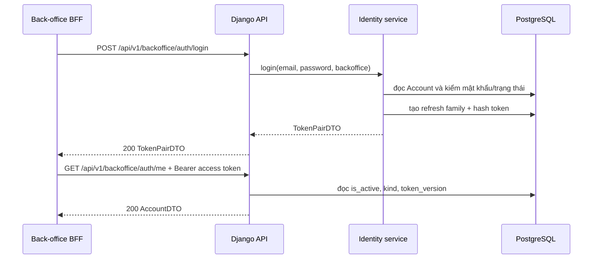

# Hướng dẫn tự code ticket 01 — Back-office login

## Mục đích của guide

Giúp bạn tự triển khai một lát cắt đăng nhập hoàn chỉnh. Mentor viết test đỏ và review; bạn viết production code. Không copy một lời giải hoàn chỉnh: làm tuần tự, dừng ở cuối mỗi step và gửi kết quả khi được yêu cầu.

## Kết quả cuối cùng

Staff/Admin gửi email + mật khẩu tới back-office login, nhận đủ `TokenPairDTO`, rồi dùng access token gọi `GET /api/v1/backoffice/auth/me`. Customer, credential sai hoặc Tài khoản vô hiệu bị từ chối bằng lỗi chung; giới hạn đăng nhập sai và trạng thái auth fail-closed tuân contract security.

## Flow tổng quan



## Bản đồ file

Đường dẫn là mục tiêu dự kiến theo kiến trúc hiện tại; nếu code lân cận cho thấy seam khác, dừng và hỏi mentor trước khi tạo convention mới.

| Thao tác | File/vị trí | File dùng để làm gì | Vì sao cần |
|---|---|---|---|
| Đọc | `backend/modules/identity/models/account.py` | Model Tài khoản và auth state | Hiểu dữ liệu login hiện có |
| Đọc | `backend/modules/identity/services/accounts.py` | Service tạo Staff/Admin | Tái dùng convention validation/transaction |
| Sửa | `backend/pyproject.toml`, `backend/uv.lock` | Thêm dependency auth/crypto/password | Dùng package và phiên bản do kiến trúc sở hữu |
| Sửa | `backend/config/env.py`, settings/check phù hợp | Đọc keyring/issuer/TTL có kiểu; bật Argon2 | Sai config fail sớm, không hard-code secret |
| Tạo | `backend/modules/identity/models/auth.py` | Schema RefreshToken/RefreshReplay | Login lưu family/hash; replay record chỉ dùng từ ticket 02 |
| Sửa | `backend/modules/identity/models/__init__.py` | Export model identity | Django/migration discovery dùng model |
| Sửa | `backend/modules/models.py` | Export model của Django app `modules` | App dùng chung một migration chain |
| Tạo | migration kế tiếp trong `backend/modules/migrations/` | Tạo bảng/constraint/index auth | Schema chỉ thay qua migration |
| Tạo | `backend/modules/identity/auth/tokens.py` | Phát/xác minh JWT Ed25519 | Tách crypto/token codec khỏi view |
| Tạo | `backend/modules/identity/auth/authentication.py` | DRF Bearer authentication | Bảo vệ endpoint bằng access token |
| Tạo | `backend/modules/identity/services/auth.py` | Login orchestration | Kiểm Account, mật khẩu, tạo refresh family/token |
| Tạo | `backend/modules/identity/auth/login_attempts.py` | Failure ledger Redis atomic | Giới hạn lần đăng nhập sai theo email/IP |
| Tạo | `backend/modules/identity/api/backoffice/serializers.py` | Validate LoginInput, serialize TokenPairDTO/AccountDTO | Không để view xử lý field thủ công |
| Tạo | `backend/modules/identity/api/backoffice/views.py` | HTTP adapter login và auth/me | View mỏng, gọi service; auth/me dùng `IsStaff` |
| Tạo | `backend/modules/identity/api/backoffice/urls.py` | Route identity back-office | Không trộn route storefront và back-office |
| Sửa | `backend/config/urls.py` | Mount back-office identity routes | Endpoint có URL thật |
| Sửa | `backend/shared/api/schema.py` hoặc seam hiện hành | 401/403/503 OpenAPI mặc định | Contract auth nhất quán |
| Mentor tạo | test trong `backend/modules/identity/tests/` | Test đỏ API/security/model | Định nghĩa hành vi bạn phải làm xanh |

## Database cần hiểu

- `Account` đã tồn tại; không tạo bảng user mới.
- Refresh token chỉ lưu SHA-256 hash, `jti`, `family_id`, expiry và trạng thái; token thô chỉ trả cho caller.
- Ticket 01 tạo schema `RefreshReplay` để data model/migration hoàn chỉnh, nhưng login không tạo replay record. Record này chỉ phát sinh khi xoay refresh token ở ticket 02.
- Login tạo Account read + refresh persistence trong transaction phù hợp. HTTP response chỉ dựng sau khi dữ liệu cần thiết commit.
- Không dùng `select_for_update` cho đọc login đơn thuần nếu chưa có race cần bảo vệ; thao tác refresh/revoke ở ticket 02 mới cần thứ tự khóa đầy đủ.
- Dùng PostgreSQL migration/constraint; không sửa DB thủ công.

## Kiến thức Python/Django cần dùng

- Type hints, dataclass/Pydantic DTO nếu convention hiện tại dùng.
- `AbstractBaseUser.check_password` và timing-safe password hash của Django.
- DRF Serializer, APIView/generic view, authentication và permission.
- `transaction.atomic`, `IntegrityError` và constraint DB.
- `PyJWT[crypto]`/`cryptography` với algorithm allow-list, claims bắt buộc và key `kid`; `argon2-cffi` cho `Argon2PasswordHasher`.
- Redis script/Lua atomic cho failure ledger; không dùng DRF throttle gần đúng thay cho bộ đếm lần đăng nhập sai.
- Không log secret/token/email thô.

## Cách viết code — khung để bạn tự hoàn thiện

Phần này mô tả cấu trúc và tư duy, không phải code hoàn chỉnh. Sau mỗi khối nhỏ, chạy test mentor chỉ định rồi mới viết tiếp.

### 1. Model persistence

- Dùng `PascalCase` cho model, `snake_case` cho field và tên hàm.
- Mỗi model chỉ khai báo dữ liệu, constraint và index; không đặt flow login trong `save()`.
- Đọc data model trước khi chọn field. Với identifier dùng `UUIDField`; với thời điểm dùng field timezone-aware; với trạng thái hữu hạn dùng `TextChoices`.
- Khung suy nghĩ:

```python
class RefreshToken(BaseModel):
    # account: token thuộc Tài khoản nào?
    # token_hash: lưu fingerprint nào thay vì token thô?
    # family_id/jti: dùng để nhận diện rotation ra sao?
    # expires_at/revoked_at: trạng thái hiệu lực được biểu diễn thế nào?

    class Meta:
        # db_table, constraints và indexes nào bảo vệ invariant ở DB?
        ...
```

Không copy dấu `...` vào implementation cuối. Bạn phải thay từng câu hỏi bằng field/constraint lấy từ tài liệu sở hữu data model.

### 2. Token codec

Viết các function nhỏ, stateless và có type hints. Tách “phát token” khỏi “xác minh token”; không tạo class chỉ chứa `@staticmethod`.

```python
def issue_access_token(*, account: Account, now: datetime) -> str:
    """Phát access token back-office cho Tài khoản hợp lệ."""
    ...


def decode_access_token(*, token: str, expected_audience: str) -> AccessClaimsDTO:
    """Xác minh chữ ký và claims rồi trả DTO đã kiểm chứng."""
    ...
```

Thứ tự bên trong validator: đọc header tối thiểu để chọn public key nội bộ bằng `kid` → cố định algorithm allow-list → verify chữ ký/issuer/audience/expiry và claims bắt buộc → kiểm `token_use` → dựng DTO. Không dùng payload chưa verify để quyết định phân quyền hoặc chọn key ngoài keyring nội bộ.

Validator còn phải kiểm kiểu claim, `iat <= exp`, thời điểm phát hành không ở tương lai quá leeway, và tách riêng access/refresh/lookup để token sai mục đích không được thử qua validator khác.

### 3. Failure ledger đăng nhập

Đóng gói failure ledger trong `identity/auth/login_attempts.py`; không nhét Lua/Redis commands vào view hoặc service. Interface cần diễn đạt được ba hành vi: giữ một suất trước khi kiểm credential, hoàn tất suất thành failure, và trả suất/xoá failure email cũ khi đăng nhập thành công.

- Key dùng HMAC của email đã chuẩn hoá hoặc IP tin cậy qua `shared.privacy`; không đưa email/IP thô vào Redis key hay log.
- Giới hạn là 5 lần sai/15 phút theo email và 20 lần sai/15 phút theo IP; lần thử tiếp theo trả `429` kèm `Retry-After`.
- Check/reserve/complete phải atomic khi Redis hoạt động; cùng request không được ghi hai failure.
- Redis lỗi thì fail-open, tiếp tục xác minh credential và phát metric không chứa định danh.
- DRF throttle chung vẫn áp dụng nhưng không thay thế failure ledger.

### 4. Login service

Service là nơi điều phối nghiệp vụ và transaction. Dùng keyword-only arguments, tên cụ thể và return type rõ ràng.

```python
def login_backoffice(*, email: str, password: str) -> TokenPairDTO:
    # 1. Chuẩn hóa email bằng cùng convention của Account manager.
    # 2. Giữ suất failure ledger theo email/IP trước khi kiểm credential.
    # 3. Tìm Account; email không tồn tại vẫn chạy dummy password verification.
    # 4. Kiểm password, is_active và loại Tài khoản bằng lỗi chung.
    # 5. Trong transaction, tạo RefreshToken; không tạo RefreshReplay.
    # 6. Phát token và trả DTO; không trả model ra API boundary.
    ...
```

Không viết ORM hoặc `transaction.atomic()` trong serializer/view. Không bắt `Exception`; chỉ chuyển các trường hợp nghiệp vụ dự kiến sang domain exception chung của login.

### 5. Serializer và view

Serializer chỉ kiểm tra hình dạng input. View validate → gọi service → serialize response; không tự query `Account`.

```python
class BackofficeLoginInputSerializer(serializers.Serializer):
    email = serializers.EmailField()
    password = serializers.CharField(write_only=True, trim_whitespace=False)


class BackofficeLoginView(APIView):
    permission_classes = [AllowAny]

    def post(self, request: Request) -> Response:
        # 1. Bind serializer với request.data.
        # 2. is_valid(raise_exception=True).
        # 3. Gọi login_backoffice bằng keyword arguments.
        # 4. Dùng output serializer/DTO mapper và trả HTTP 200.
        ...
```

`GET backoffice/auth/me` dùng `JWTAuthentication` và permission `IsStaff` đã có trong `shared/api/permissions.py`; không tạo permission trùng lặp. Authentication xác minh token, đọc Tài khoản từ PostgreSQL ở mọi request back-office và đối chiếu `is_active`, `kind`, `token_version`. DB không xác minh được phải trả `503 AUTH_STATE_UNAVAILABLE`, không dùng cache để chấp nhận token.

Password phải là `write_only`; không log `request.data`, email hoặc token. `TokenPairDTO` gồm đủ `access_token`, `refresh_token`, `token_type = "Bearer"`, `expires_in`; `auth/me` trả `AccountDTO` và không lộ password/token hash/token version.

### 6. Cách xử lý khi chưa biết viết dòng tiếp theo

1. Viết comment một câu mô tả hành vi tiếp theo.
2. Xác định dữ liệu vào và kiểu dữ liệu trả ra.
3. Tìm một ví dụ cùng tầng trong repository, không tìm theo tên giống ngẫu nhiên.
4. Viết phần nhỏ nhất làm test hiện tại tiến xa hơn.
5. Chạy formatter/test, đọc traceback từ dưới lên và sửa nguyên nhân đầu tiên.
6. Khi test xanh, xoá comment chỉ lặp lại code; giữ comment giải thích lý do hoặc invariant.

## Step 1 — Chạy baseline và đọc code

### Mục tiêu

Biết repository đang xanh và mô tả được Account hiện được tạo/kiểm mật khẩu thế nào.

### Việc bạn làm

1. Từ `backend/`, chạy `make lint` và targeted identity tests hiện có.
2. Đọc `Account`, service `create_staff_account`, permissions và settings REST framework.
3. Viết bằng lời flow login dự kiến: request → serializer → service → model/DB → DTO.

### Kết quả cần có

- Output baseline.
- Danh sách file đã đọc.
- Flow 5–8 dòng bằng lời của bạn.

### Dừng và gửi mentor

Chưa tạo file. Gửi baseline + flow để mentor xác nhận seam.

## Step 2 — Nhận test đỏ từ mentor

### Mục tiêu

Thấy hành vi đầu tiên cần làm xanh: Staff đăng nhập thành công.

### Mentor làm

- Tạo test API login thành công và test response `TokenPairDTO` tối thiểu.
- Giải thích arrange/act/assert và tại sao test đang đỏ.

### Việc bạn làm

1. Chạy đúng test mentor chỉ định.
2. Đọc traceback, xác định failure đầu tiên là route/serializer/service hay model.
3. Không sửa test để làm xanh.

### Kết quả cần có

- Test đỏ đúng lý do endpoint/capability chưa tồn tại.
- Bạn giải thích được output mong đợi.

## Step 3 — Thêm dependencies và cấu hình auth

### Mục tiêu

Project có dependency/config thật cho JWT Ed25519, Argon2 và failure ledger trước khi viết production flow.

### Việc bạn làm

1. Thêm đúng dependency/phiên bản được kiến trúc sở hữu vào `pyproject.toml` và cập nhật lockfile.
2. Thêm typed env/settings cho issuer, keyring, audience/TTL và cấu hình liên quan; cập nhật `.env.example` bằng placeholder, không đọc hoặc commit secret thật.
3. Đặt `Argon2PasswordHasher` đầu `PASSWORD_HASHERS` và giữ các hasher phù hợp để xác minh/nâng cấp hash cũ.
4. Viết config/startup tests cho thiếu key, `kid` không hợp lệ và TTL sai.

### Dừng và gửi mentor

Gửi dependency/config diff và output config tests trước khi tạo model.

## Step 4 — Tạo persistence auth và migration

### Mục tiêu

Có schema tối thiểu để login lưu refresh family an toàn.

### Việc bạn làm

1. Tạo `models/auth.py` theo data model, gồm `RefreshToken` và `RefreshReplay`.
2. Export model đúng app `modules`.
3. Sinh migration, đọc migration trước khi chạy.
4. Chạy migrate và model/migration tests mentor cung cấp.

### Kết quả cần có

- Bảng, constraint/index đúng đặc tả.
- Không lưu token thô.
- Login chưa tạo `RefreshReplay`; bảng này dành cho rotation/replay ở ticket 02.
- Migration forward trên DB test qua.

### Dừng và gửi mentor

Gửi migration + model diff trước khi viết JWT codec.

## Step 5 — Viết token codec

### Mục tiêu

Phát được access/refresh token đúng claims mà không hard-code secret.

### Việc bạn làm

1. Viết codec phát token với `kid`, EdDSA và claims bắt buộc.
2. Viết validator access chỉ nhận đúng algorithm/audience/`token_use`.
3. Chạy security matrix mentor cung cấp.

### Kết quả cần có

- Token đúng/khác audience/`token_use` cho kết quả dự kiến.
- Sai key/config fail rõ, không lộ secret.

## Step 6 — Viết failure ledger

### Mục tiêu

Giới hạn lần đăng nhập sai chính xác khi Redis hoạt động mà không biến email/IP thành dữ liệu lộ trong cache hoặc log.

### Việc bạn làm

1. Viết interface nhỏ trong `identity/auth/login_attempts.py`.
2. Dùng Redis script atomic cho reserve/complete/release và cửa sổ trượt.
3. Trả `Retry-After` từ suất/failure chặn sớm nhất.
4. Viết tests cho boundary, request đồng thời, timeout lease và Redis fail-open có metric.

### Dừng và gửi mentor

Gửi interface, script và kết quả concurrency tests trước khi nối credential flow.

## Step 7 — Viết login service

### Mục tiêu

Service nhận credential và trả DTO độc lập HTTP.

### Việc bạn làm

1. Chuẩn hóa email giống Account manager.
2. Reserve failure ledger theo email/IP tin cậy trước khi thử password.
3. Tìm Account; dùng dummy password verification nếu email không tồn tại.
4. Kiểm kind/is_active/password bằng lỗi chung; ghi failure hoặc release/reset đúng contract.
5. Tạo refresh family/hash và phát token; không tạo `RefreshReplay`.
6. Không catch mọi exception hoặc log credential.

### Kết quả cần có

- Service test đúng credential xanh.
- Sai credential/kind/active không lộ nguyên nhân.

### Dừng và gửi mentor

Gửi service diff và giải thích transaction boundary.

## Step 8 — Viết serializer, view và URL login

### Mục tiêu

Nối HTTP request tới service bằng view mỏng.

### Việc bạn làm

1. Tạo LoginInput serializer với field tường minh.
2. View dùng `AllowAny`, gọi service và trả TokenPairDTO 200.
3. Mount route back-office đúng prefix.
4. Khai OpenAPI request/response/error/example.

### Kết quả cần có

- Test login thành công xanh.
- View không chứa ORM/crypto/business logic.

## Step 9 — Bảo vệ `auth/me` bằng access token

### Mục tiêu

Chứng minh token nhận được thực sự dùng được cho back-office.

### Việc bạn làm

1. Hoàn thiện `JWTAuthentication`: xác minh access token rồi đọc Tài khoản từ PostgreSQL và đối chiếu `is_active`, `kind`, `token_version`.
2. Tạo `GET /api/v1/backoffice/auth/me`, dùng `IsStaff` hiện có và trả `AccountDTO`.
3. Kiểm DB auth state trên mọi request; DB lỗi trả `503 AUTH_STATE_UNAVAILABLE`.
4. Khai OpenAPI cho 200/401/403/503 và test Staff/Admin/Customer/ẩn danh.

### Kết quả cần có

- Staff/Admin token qua; Customer, token `aud=store` hoặc sai `token_use` bị từ chối.

## Step 10 — Làm xanh security matrix, refactor và chạy gate

### Mentor làm

Bổ sung test cho:

- credential sai, Customer, inactive và email không tồn tại dùng dummy password verification;
- sai/thiếu `alg`, `kid`, issuer, audience, `token_use` hoặc claim bắt buộc;
- claim sai kiểu, expiry, future `iat`, leeway, `iat > exp` và `token_version` lệch;
- refresh-as-Bearer, token storefront dùng cho back-office và DB unavailable;
- failure ledger theo email/IP, boundary cửa sổ, concurrency, `Retry-After`, lease timeout và Redis fail-open.

### Việc bạn làm

Sửa production code, không sửa expectation hợp lệ; hỏi mentor nếu contract mâu thuẫn tài liệu. Sau khi matrix xanh:

1. Chạy `make fmt`.
2. Chạy `make lint`.
3. Chạy targeted tests.
4. Sinh/check OpenAPI nếu endpoint đã thêm.
5. Gửi diff cho mentor review theo Blocker/Important/Suggestion.

## Checklist gửi review

- [ ] Tôi mô tả được vì sao cần RefreshToken persistence khi login.
- [ ] View không có business logic.
- [ ] Không lưu/log token thô hoặc credential.
- [ ] Token `aud=store`/`aud=backoffice`/`token_use` không dùng chéo.
- [ ] Login tạo `RefreshToken` nhưng không tạo `RefreshReplay`.
- [ ] Failure ledger atomic khi Redis hoạt động và fail-open có metric khi Redis lỗi.
- [ ] `auth/me` tái dùng `IsStaff` và đọc trạng thái Tài khoản từ PostgreSQL.
- [ ] Migration/targeted test/lint xanh.
- [ ] Tôi gửi command output và nêu phần chưa hiểu.

## Worklog hiện tại

- Ticket: 01 — Back-office login
- Step: 1
- Test đang đỏ: chưa có
- Điều tôi hiểu:
- Điều tôi chưa hiểu:
- Câu hỏi cho mentor:
