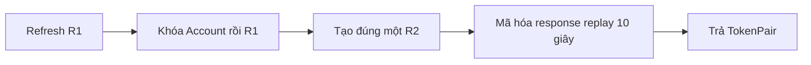

# Guide ticket 02 — Refresh và logout

## Mục đích và kết quả

Bạn tự code refresh rotation/replay/logout trên nền token của ticket 01; mentor viết test crypto/concurrency/API. Kết quả: một predecessor chỉ có một successor và logout khóa family.

## Flow

## Bản đồ file

| Tạo/sửa ở đâu | Dùng làm gì | Mục đích |
|---|---|---|
| `modules/identity/services/auth.py` | refresh/logout orchestration | Giữ transaction và thứ tự khóa |
| `modules/identity/auth/tokens.py` | validate refresh/phát successor | Tách token codec |
| `modules/identity/api/serializers.py`, `views.py`, `urls.py` | RefreshInput/LogoutInput và HTTP | Nối API mỏng |
| `modules/identity/tasks.py`, Celery schedule | purge replay hết hạn | Dọn dữ liệu ngắn hạn |
| identity tests (mentor tạo) | concurrency/replay/revoke | Định nghĩa hành vi |

## Cách viết code và thứ tự thực hiện

Ở mỗi Step, hãy viết theo chu kỳ: xác định function signature có type hints → viết pseudo-code bằng comment → triển khai một nhánh → chạy test mentor cung cấp → refactor. Service giữ transaction/row lock; view và serializer chỉ làm HTTP boundary. Không chép nguyên flow thành một function dài.

1. **Step 1:** Đọc ADR 0014 và vẽ state R1→R2→R3.
2. **Step 2:** Nhận test đỏ refresh lần đầu từ mentor.
3. **Step 3:** Viết service khóa Account→token, tạo successor + replay cùng transaction.
4. **Step 4:** Nối refresh API, làm xanh happy path.
5. **Step 5:** Mentor thêm concurrent/retry/superseded/reuse tests; bạn làm xanh.
6. **Step 6:** Viết logout service/API và purge task.
7. **Step 7:** Chạy fmt/lint/tests/OpenAPI, gửi diff review.

## Kiến thức cần dùng

`select_for_update`, transaction isolation, AESGCM/AAD, self-FK, idempotent revoke, DRF API.
