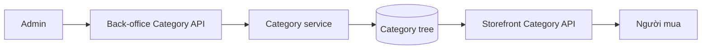

# Guide ticket 03 — Danh mục và navigation

## Mục đích và flow

Admin quản lý cây Danh mục; storefront đọc cùng cây để điều hướng.

## Bản đồ file

| Vị trí dự kiến | Dùng làm gì | Vì sao cần |
|---|---|---|
| `modules/catalog/models/category.py` | Category schema/invariant | Lưu cây |
| `modules/migrations/` | Schema/index | Thay DB có kiểm soát |
| `modules/catalog/services/categories.py` | create/update/delete/cycle check | Business write |
| `modules/catalog/selectors/categories.py` | dựng cây | Read seam dùng chung |
| `modules/catalog/api/backoffice/` | Admin CRUD | Quản trị |
| `modules/catalog/api/store/` | public tree | Navigation storefront |
| tests do mentor tạo | API/tree/permission | Đường ray implementation |

## Cách viết code và thứ tự thực hiện

Ở mỗi Step, viết model trước để biểu diễn invariant cục bộ, service cho thao tác ghi và selector cho cây đọc. Mỗi public function dùng keyword-only arguments và return type. Viết pseudo-code cho kiểm tra cycle trước khi chuyển thành ORM; API view không query model trực tiếp.

1. **Step 1:** Đọc schema/BR và nhận test đỏ tạo root+child.
2. **Step 2:** Tạo model/migration, làm xanh persistence.
3. **Step 3:** Viết service cycle-safe và back-office API.
4. **Step 4:** Viết selector cây và storefront API.
5. **Step 5:** Làm xanh permission/audit/delete conflict tests.
6. **Step 6:** Chạy gates và gửi diff review.

## Kiến thức

Self-FK, PROTECT, tree traversal, transaction, DRF nested response, stable ordering.
