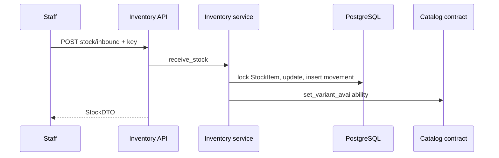

# Guide ticket 08 — Xem Tồn kho và Nhập kho

## Mục đích và flow

Staff xem Tồn kho rồi Nhập kho; mutation tạo movement và cập nhật availability Catalog.

## Bản đồ file

| Vị trí | Dùng làm gì | Mục đích |
|---|---|---|
| `inventory/models/` | Warehouse/StockItem/Movement | Persistence/invariant |
| migration | tables + MAIN seed + FK | DB schema |
| `inventory/services/stock.py` | receive_stock | Atomic write |
| `inventory/selectors/stock.py` | list/filter | Read API |
| `inventory/contracts.py` | get_available | Boundary cho mốc sau |
| `inventory/api/backoffice/` | GET stock/POST inbound | Staff capability |
| tests mentor tạo | idempotency/concurrency/projection | Bảo vệ invariant |

## Cách viết code và thứ tự thực hiện

Ở mỗi Step, viết command DTO/signature trước, sau đó service theo thứ tự: validate → mở transaction → lock → kiểm invariant → ghi movement/projection → trả DTO. Selector chịu trách nhiệm đọc; view không giữ row lock hoặc tự cập nhật Tồn kho.

1. **Step 1:** Nhận test đỏ GET stock/POST inbound flow.
2. **Step 2:** Tạo models/migration/MAIN seed.
3. **Step 3:** Viết selector + GET stock.
4. **Step 4:** Viết receive_stock với row lock/movement/projection.
5. **Step 5:** Nối Idempotency-Key + POST API.
6. **Step 6:** Làm xanh permission/replay/race tests, chạy gates/review.

## Kiến thức

`select_for_update`, atomic mutation+history, idempotency claim, FK/import boundary, pagination/query optimization.
