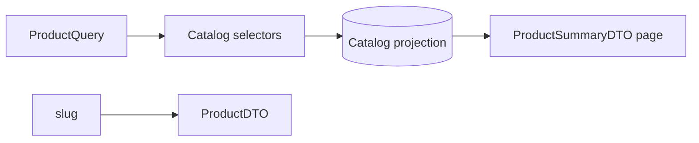

# Guide ticket 11 — Storefront khám phá Sản phẩm

## Mục đích

Người mua công khai duyệt/tìm/lọc và xem chi tiết với đúng giá/ảnh/availability.

## Flow

## Bản đồ file

| Vị trí | Dùng làm gì | Mục đích |
|---|---|---|
| `catalog/selectors/products.py` | list/filter/search/detail | Một read seam tối ưu |
| catalog filter/query schema | ProductQuery | Validate query |
| `catalog/api/store/` | public list/detail | Storefront capability |
| migration/index nếu thiếu | unaccent/trigram/index | Query performance |
| tests mentor tạo | US-101–104/query count | Contract/read behavior |

## Cách viết code và thứ tự thực hiện

Ở mỗi Step, viết response DTO và selector signature trước để biết query cần dữ liệu gì. Xây QuerySet theo từng filter, dùng `select_related`/`prefetch_related` có chủ đích rồi chuyển kết quả sang DTO. View chỉ parse query parameters và gọi selector.

1. **Step 1:** Nhận test đỏ list active cơ bản.
2. **Step 2:** Viết selector list + pagination DTO.
3. **Step 3:** Thêm filter/search/sort từng nhóm test.
4. **Step 4:** Viết detail selector/API với images/variants/pricing.
5. **Step 5:** Làm xanh hidden/out-of-stock/query-count/index-plan tests.
6. **Step 6:** Chạy gates/review.

## Kiến thức

Django ORM Exists/Subquery/annotation, unaccent/trigram, escaping LIKE, distinct/pagination, prefetch optimization.
