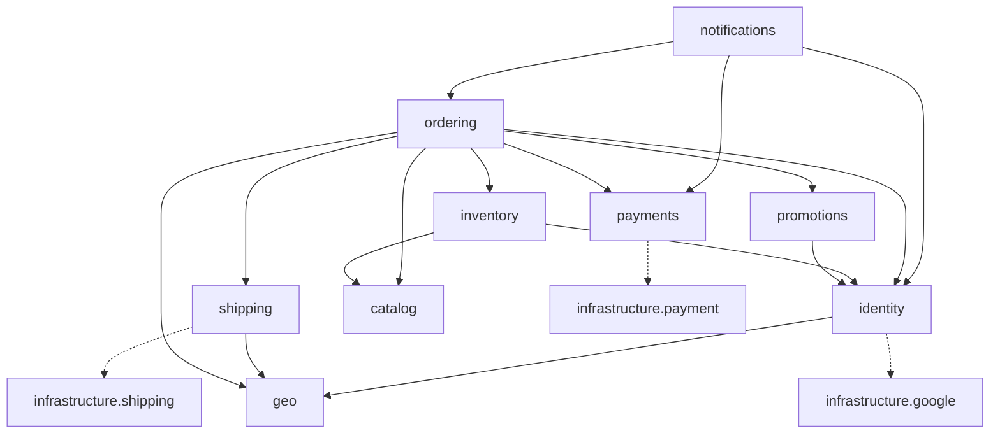

# 02. Cấu trúc Backend

> Trạng thái: **Đã chốt cho MVP** ([quy ước](../../README.md#trạng-thái-tài-liệu)). Quyết định nền tảng: [ADR 0018](../adr/0018-one-django-app-per-module.md) (mỗi module một Django app), [ADR 0007](../adr/0007-events-outbox-celery-no-kafka.md) (sự kiện).
> Thuật ngữ nghiệp vụ theo [GLOSSARY.md](../../GLOSSARY.md).
> **Cấu trúc đích.** Code hiện vẫn ở bố cục cũ (`backend/`, `shared/`, `modules/`) cho tới khi ticket chuyển cấu trúc theo ADR 0018 hoàn tất.

File này là **bản đồ** của repo: code đặt ở đâu, file nào được import gì, module nói chuyện với nhau ra sao. Chi tiết nằm ở nơi sở hữu:

| Cần biết | Đọc |
|---|---|
| Mỗi module chứa gì, public API, quy tắc riêng | [`modules/`](./modules/README.md) |
| Package dùng và không dùng, lý do | [14](./14-dependencies.md) |
| Cách viết code, transaction, naming | [13](./13-python-django-coding-style.md) |
| Loại test, marker, cổng CI | [12](./12-testing-strategy.md) |
| Schema và ràng buộc dữ liệu | [03](./03-data-model.md) |

## 1. Tổng quan

- **Một Django project** nằm ngay ở gốc repo, deploy một lần, chạy thành nhiều tiến trình: API, Celery worker, Celery Beat, Outbox relay.
- **Ba nhóm code**:
  - `apps/`: nghiệp vụ. Mỗi **module** (một vùng nghiệp vụ có ranh giới, ví dụ `ordering`) là **đúng một Django app**.
  - `common/`: hạ tầng nội bộ dùng chung (sự kiện, idempotency, nền DRF…). Không phải module, không chứa nghiệp vụ.
  - `infrastructure/`: code gọi API bên thứ ba (VNPay, MoMo, GHN, Google). Không phải module.
- Code theo **HackSoft Django Styleguide**: model giữ dữ liệu và ràng buộc, `services` ghi, `selectors` đọc, view chỉ nhận request rồi gọi service hoặc selector.

| Hạng mục | Lựa chọn |
|---|---|
| Ngôn ngữ, framework | Python 3.14, Django 5.2 LTS, Django REST Framework |
| Database | PostgreSQL 18 (`unaccent`, `pg_trgm`, `btree_gist`) |
| Cache, broker | Redis (chạy bằng Valkey 8) |
| Background jobs | Celery + Celery Beat |
| Quản lý package | uv (`pyproject.toml` + `uv.lock`) |

## 2. Cây thư mục

Cây chỉ ghi vai trò. Mục đánh dấu _(kế hoạch)_ chưa có trong code. Cây chi tiết của từng module nằm ở file của module đó.

```
<repo>/
├── manage.py
├── pyproject.toml              # dependency; cấu hình ruff, mypy, pytest, coverage, import-linter
├── uv.lock
├── Makefile                    # make fmt, lint, test, migrate, openapi…
├── Dockerfile                  # 1 image cho worker, beat, relay, migrate (ADR 0017)
├── docker-compose.yml          # worker, beat, relay, redis, mailpit (08 mục 7)
├── openapi.yaml                # schema đã commit; CI chặn drift (12 mục 5)
├── conftest.py                 # fixture dùng chung: customer_client, staff_client, admin_client…
├── .env.example                # mẫu biến môi trường (.env thật không commit)
│
├── config/                     # cấu hình project, không chứa nghiệp vụ
│   ├── env.py                  # đọc và kiểm biến môi trường (pydantic-settings)
│   ├── settings/               # base, local, test, production (mục 7)
│   ├── urls.py                 # /api/v1/{store,backoffice,webhooks}, schema, health
│   ├── celery.py               # Celery app, queue, lịch job
│   └── wsgi.py
│
├── apps/                       # mỗi thư mục con là một module = một Django app (mục 3)
│   ├── geo/  identity/  catalog/  payments/  shipping/
│   └── inventory/  promotions/  ordering/  notifications/
│
├── common/                     # Django app hạ tầng nội bộ, không import apps/ hay infrastructure/
│   ├── models.py               # BaseModel, uuid7()
│   ├── exceptions.py           # DomainError, RetryLater
│   ├── tasks.py                # enqueue_on_commit: đẩy task sau commit
│   ├── values/                 # money.py (Money), phones.py (chuẩn hoá số điện thoại)
│   ├── security/               # privacy.py (pii_hmac), checks.py (kiểm secret khi deploy)
│   ├── observability/          # logging.py (structlog, che PII), health.py (/healthz, /readyz)
│   ├── api/                    # nền DRF: ErrorDTO, schema, pagination, permission, throttling, middleware
│   ├── events/                 # outbox: publish, @handles, relay, consumer; testing.py (drain_events)
│   ├── idempotency/            # Idempotency-Key (04 mục 1)
│   ├── management/commands/    # run_outbox_relay, replay_events, retry_failed_events, sync_beat_schedule, reset_db
│   ├── migrations/
│   └── tests/                  # test của common, soi gương cây ở trên; factories.py
│
├── infrastructure/             # (kế hoạch) code gọi API bên thứ ba; không import apps/, không đọc DB;
│                               # tạo cùng adapter đầu tiên
│   ├── payment/                # base.py (PaymentGateway), vnpay.py, momo.py, fake.py
│   ├── shipping/               # base.py (ShippingProvider), ghn.py, fake.py
│   └── google/                 # oauth.py: xác minh id_token
│
├── tests/                      # test không thuộc một app
│   ├── flows/                  # (kế hoạch) luồng xuyên module: checkout → giao → hoàn tất
│   └── tooling/                # env, script, ranh giới import, marker pytest
│
├── scripts/                    # công cụ dev và CI, không import khi chạy app
│   ├── setup/                  # dựng role và DB PostgreSQL local (08 mục 2.2)
│   ├── gen_importlinter.py     # sinh contract import-linter (mục 6)
│   ├── gen_openapi.py          # sinh openapi.yaml, --check so drift
│   └── check_module_coverage.py, br_report.py, _modules.py
│
├── docs/                       # business/, architecture/, adr/
├── .github/                    # CI (ci.yml, codeql.yml), dependabot, mẫu issue và PR (11)
├── .scratch/                   # spec và ticket theo feature (docs/agents/issue-tracker.md)
├── .claude/, .agents/          # skill và hook cho AI agent
├── .vscode/, .run/             # cấu hình IDE được commit (08 mục 6, 11)
├── .pre-commit-config.yaml     # gitleaks, ruff, mypy, import-linter, commitizen
├── .editorconfig               # UTF-8, LF, thụt lề 4 cho Python, 2 cho YAML/JSON/TOML
├── .gitattributes              # ép LF kể cả trên Windows; .bat/.cmd/.ps1 giữ CRLF
├── .gitignore, .dockerignore   # .dockerignore loại docs/, .scratch/, .claude/ khỏi image
├── .gitleaksignore             # ngoại lệ gitleaks cho dữ liệu mẫu, mỗi dòng có lý do
├── .sonarcloud.properties      # loại file sinh tự động (openapi.yaml) khỏi SonarCloud
├── pyrightconfig.json          # Pylance dùng .venv của repo
├── CLAUDE.md, AGENTS.md        # quy tắc cho AI agent; AGENTS.md chỉ trỏ về CLAUDE.md
├── GLOSSARY.md                 # thuật ngữ nghiệp vụ
└── README.md, CONTRIBUTING.md, SECURITY.md, LICENSE
```

Các file cấu hình repo (`.pre-commit-config.yaml`, `.sonarcloud.properties`, `.gitleaksignore`, `CLAUDE.md`…) nằm ở gốc vì công cụ chỉ đọc chúng ở đó.

## 3. Module và thứ tự phụ thuộc

| Lớp | Module | Sở hữu |
|---|---|---|
| 6 | [`notifications`](./modules/notifications.md) | Email theo sự kiện |
| 5 | [`ordering`](./modules/ordering.md) | Giỏ hàng, checkout, Đơn hàng, Đổi trả, Cờ cần xử lý |
| 4 | [`inventory`](./modules/inventory.md) | Kho, Tồn kho, Giữ hàng, Hàng chờ xuất, Kiểm kê |
| 4 | [`promotions`](./modules/promotions.md) | Voucher, Lượt dùng Voucher |
| 3 | [`identity`](./modules/identity.md) | Tài khoản, xác thực, sổ địa chỉ, đồng ý và xoá dữ liệu cá nhân |
| 3 | [`catalog`](./modules/catalog.md) | Danh mục, Sản phẩm, Biến thể, Giá bán, Giá khuyến mãi |
| 3 | [`payments`](./modules/payments.md) | Thanh toán online và COD, Hoàn tiền, Đối soát |
| 3 | [`shipping`](./modules/shipping.md) | Phí ship, Vận đơn GHN, Đối soát |
| 2 | [`geo`](./modules/geo.md) | Tỉnh/thành, phường/xã (địa giới 2 cấp) |
| 1 | `infrastructure`, `common` | Không phải module; `infrastructure` được import `common`, không ngược lại |



`A --> B`: A gọi `B/contracts.py`, nghe sự kiện trong `B/events.py` hoặc có FK tới model của B. Nét đứt: module dùng adapter bên thứ ba của riêng nó. Mọi module đều dùng `common` nên sơ đồ không vẽ. Quy tắc mà CI kiểm là theo lớp:

- Module được phụ thuộc vào **mọi** module ở lớp thấp hơn.
- **Không** phụ thuộc module cùng lớp (ví dụ `payments` và `shipping` độc lập) hay lớp cao hơn.
- **Lớp dưới báo cho lớp trên bằng sự kiện.** Ví dụ `payments` không biết Đơn hàng: nó nhận `reference` (Mã đơn) và phát `payments.payment-succeeded`; `ordering` nghe sự kiện này để chuyển trạng thái đơn.

## 4. Khuôn mẫu một module

Mọi module theo cùng khuôn. Chỉ tạo file khi có nội dung.

```
apps/<module>/
├── __init__.py
├── apps.py           # AppConfig: name = "apps.<module>", label = "<module>"
├── contracts.py      # ⭐ public API: hàm + DTO cho module khác gọi
├── events.py         # ⭐ sự kiện module phát ra (pydantic, có version)
├── exceptions.py     # ⭐ lỗi nghiệp vụ module khác được bắt
├── constants.py      # TextChoices, hằng số
├── models.py         # hoặc models/ (mục 4.2)
├── services.py       # hoặc services/: nghiệp vụ ghi
├── selectors.py      # hoặc selectors/: truy vấn đọc
├── handlers.py       # nghe sự kiện của module khác
├── tasks.py          # Celery task mỏng
├── auth/             # tuỳ chọn: adapter hạ tầng riêng của module (chỉ identity)
├── api/
│   ├── permissions.py
│   └── store/ | backoffice/ | webhooks/   # serializers.py, views.py, urls.py
├── management/commands/
├── templates/        # chỉ notifications: emails/
├── migrations/
└── tests/            # soi gương cây ở trên (mục 4.4); factories.py
```

### 4.1. Vai trò từng file

Cột "Cấm" chỉ ghi ranh giới import. Quy tắc hành vi (transaction, HTTP, đẩy task, handler) ở [13 mục 3.3](./13-python-django-coding-style.md#33-quy-tắc-theo-file-của-module) và [13 mục 4](./13-python-django-coding-style.md#4-service-transaction-và-tác-vụ-bên-ngoài).

| File | Chứa gì | Được import | Cấm |
|---|---|---|---|
| `contracts.py` | Hàm công khai và DTO pydantic, chỉ những gì module khác thực sự cần | `services`, `selectors` của chính module; `contracts` lớp dưới | Trả model Django ra ngoài |
| `events.py` | Class sự kiện, ví dụ `OrderPlacedV1` với `event_type = "ordering.order-placed"`, `schema_version = 1` | `common.events` | Logic nghiệp vụ |
| `exceptions.py` | Lỗi kế thừa `DomainError` hoặc `RetryLater`. Lỗi thuộc module ném ra nó, module khác import để bắt, không khai báo lại | `common.exceptions` | Import model |
| `constants.py` | `TextChoices` và hằng số | — | Import model |
| `models` | Field, constraint, index, `Meta.db_table` có tiền tố là label của app | `common.models`; `models` lớp dưới chỉ để khai FK (mục 5) | Logic nghiệp vụ |
| `services` | Mỗi nghiệp vụ ghi một hàm | Model của chính module; `contracts` lớp dưới; `infrastructure.<của module>` | `api/`, `tasks.py`, `request`; model của module khác |
| `selectors` | Hàm đọc, tối ưu `select_related`, `prefetch_related` | Model của chính module; hàm **chỉ đọc** trong `contracts` lớp dưới | Ghi dữ liệu; model của module khác |
| `handlers.py` | Hàm `@handles(...)`, mỗi hàm gọi **một** service của chính module | `services` của chính module; `events` lớp dưới | `contracts` của module khác (service làm việc này) |
| `tasks.py` | Celery task mỏng, chỉ gọi service | `services` | Logic nghiệp vụ |
| `api/*/serializers.py` | Validate vào, định dạng ra | — | Logic nghiệp vụ |
| `api/*/views.py` | Phân quyền, gọi serializer, gọi service/selector | `services`, `selectors`, `serializers` | ORM trực tiếp |
| `api/permissions.py` | Permission gắn nghiệp vụ, ví dụ `IsOrderOwner`; permission chung ở `common/api/permissions.py` | `selectors` của chính module; `contracts` chỉ đọc lớp dưới | Ghi dữ liệu |
| `auth/` | Adapter hạ tầng riêng của `identity` (JWT, Redis login ledger, DRF authentication) | Model, `constants`, `exceptions` của chính module | Bị module khác import |
| `tests/` | Test service (nhiều nhất), handler, API | Mọi thứ của module; `common.tests.factories`; `tests.factories` và `contracts` lớp dưới | Phần nội bộ của module khác ([12](./12-testing-strategy.md) mục 4) |

### 4.2. Một file hay một package

Bắt đầu bằng **một file** (`models.py`, `services.py`, `selectors.py`). Tách thành package khi file chứa **từ hai khái niệm nghiệp vụ độc lập**, tức đọc phần này không cần đọc phần kia (ví dụ Giỏ hàng và Đổi trả). File trong package đặt tên theo khái niệm (`checkout.py`, `transitions.py`), không theo kiểu kỹ thuật.

| Module | `models` | `services` | `selectors` | Khác |
|---|---|---|---|---|
| `geo` | file | — | file | |
| `identity` | package | package | file | `auth/` |
| `catalog` | package | file | file | |
| `inventory` | file | file | file | |
| `promotions` | file | file | — | |
| `payments` | file | file | — | dùng `infrastructure.payment` |
| `shipping` | file | file | — | dùng `infrastructure.shipping` |
| `ordering` | package | package | package | |
| `notifications` | file | file | — | `templates/emails/` |

### 4.3. Một request đi qua các tầng

```
views.CreateThingView.post(request)
  → serializers.CreateThingInput(data=request.data).is_valid(raise_exception=True)
  → services.create_thing(**validated_data)          # transaction.atomic
       → <lower>.contracts.get_something(ids)         # module lớp dưới, nhận DTO
       → Thing.objects.create(...)
       → common.events.publish(ThingCreatedV1(...))   # ghi outbox cùng transaction
  → serializers.ThingOutput(thing).data
```

Ví dụ đầy đủ nhất là checkout, ở [`ordering` mục 5.1](./modules/ordering.md#51-luồng-checkout).

### 4.4. Test đặt ở đâu, tên là gì

Test nằm trong `tests/` của app sở hữu. **Đường dẫn test soi gương đường dẫn code**, thêm `test_` trước tên file: nhìn tên file test là biết nó kiểm file nào.

| Code | Test |
|---|---|
| `apps/ordering/services/checkout.py` | `apps/ordering/tests/services/test_checkout.py` |
| `apps/promotions/services.py` | `apps/promotions/tests/test_services.py` |
| `apps/identity/api/backoffice/views.py` | `apps/identity/tests/api/backoffice/test_views.py` |
| `common/api/pagination.py` | `common/tests/api/test_pagination.py` |
| `infrastructure/payment/vnpay.py` | `infrastructure/tests/payment/test_vnpay.py` |

- Test không gắn với một file nguồn (tranh chấp khoá nhiều connection) đặt ở `tests/concurrency/` của app.
- Factory của module ở `apps/<module>/tests/factories.py`; factory nền ở `common/tests/factories.py`.
- Test xuyên module ở `tests/flows/` ở gốc; test công cụ (script, env, ranh giới import) ở `tests/tooling/`.

## 5. Giao tiếp giữa module

Module khác chỉ được dùng ba file: `contracts.py` (gọi đồng bộ), `events.py` (nghe sự kiện), `exceptions.py` (bắt lỗi).

**FK sang module lớp dưới** được phép ([ADR 0018](../adr/0018-one-django-app-per-module.md)), nhưng **chỉ để database giữ toàn vẹn dữ liệu**, không để truy vấn xuyên module:

- Khai FK bằng class được import (`models.ForeignKey(Variant, …)`), kể cả FK tới `Account`. Không dùng chuỗi (`"catalog.Variant"`, `settings.AUTH_USER_MODEL`): có import thật thì contract `layers` mới kiểm được chiều FK.
- Trong `services` và `selectors`, không dùng lookup `__`, `select_related`, `prefetch_related` đi vào model của module khác. ORM đi qua FK mà không cần import nên `import-linter` không thấy, và schema của module kia sẽ ngầm thành interface: đổi tên field có thể làm hỏng module khác trong khi CI vẫn xanh. Quy tắc này chỉ kiểm được khi review.
- Đọc cột FK của chính bảng mình (`stock_item.variant_id`) thì được.
- Cần dữ liệu module khác thì gọi `contracts` với **danh sách id**, một lần cho cả trang, để không sinh N+1.

## 6. Kiểm tra ranh giới bằng `import-linter`

`make lint` và CI chặn các vi phạm sau:

| Quy tắc | Contract |
|---|---|
| Thứ tự lớp ở mục 3 | `layers`, viết tay trong `pyproject.toml` |
| Module khác chỉ import `contracts`, `events`, `exceptions` | `forbidden`, sinh tự động cho mỗi cặp module |
| Mỗi package của `infrastructure` chỉ module sở hữu import | `forbidden`, viết tay |
| Code ngoài `tests` không import factory của module khác | `forbidden`, sinh tự động |
| Module chỉ phát sự kiện qua `common.events.publish`, không import relay | `forbidden`, sinh tự động |

Vùng sinh tự động nằm giữa `# BEGIN gen_importlinter` và `# END gen_importlinter`, **không sửa tay**. Thêm module hoặc file nội bộ mới thì chạy `uv run python scripts/gen_importlinter.py`. Cơ chế sinh ghi ở docstring của script.

## 7. Settings theo môi trường

Mỗi file môi trường `from config.settings.base import *` rồi ghi đè.

| File | Ghi đè chính | Ai chọn |
|---|---|---|
| `base.py` | `DEBUG = False`, `AUTH_USER_MODEL = "identity.Account"`, `DEFAULT_AUTHENTICATION_CLASSES` rỗng (khai theo view, 05 mục 4), connection pool của Django 5.2 | Không dùng trực tiếp |
| `local.py` | `DEBUG = True`, email sang Mailpit, log dạng text | `manage.py`, mặc định của `config/env.py` |
| `test.py` | Tắt connection pool, cache `LocMemCache`, Celery eager, email `locmem`, hasher MD5 | `pytest` (`pyproject.toml`), `gen_openapi.py` |
| `production.py` | HTTPS redirect (trừ `/healthz`, `/readyz`), HSTS, header bảo mật, tắt API docs; S3, SES, Sentry khi dựng AWS ([09](./09-deployment-aws-target.md)) | Biến môi trường của task ECS |

Biến môi trường chỉ đọc ở `config/env.py`: thiếu hoặc sai kiểu thì dừng ngay khi khởi động. `wsgi.py` và `celery.py` **không** đặt mặc định `DJANGO_SETTINGS_MODULE`, để process deploy thiếu biến không âm thầm chạy bằng settings local.

## 8. Khác với cấu trúc Django phổ biến

Cấu trúc `config/` + `apps/` + `common/` + `infrastructure/` theo cách phổ biến của cộng đồng Django. Những chỗ dự án cố ý làm khác:

| Thường thấy | Dự án | Vì sao |
|---|---|---|
| App gọi selector hoặc model của app khác | Chỉ qua `contracts`, `events`, `exceptions` | Model nội bộ không thành interface công khai (mục 5) |
| Bọc service gọi cổng thanh toán trong `@transaction.atomic` | Không gọi HTTP trong transaction | Không giữ khoá DB khi chờ mạng (13 mục 4) |
| `task.delay()` trong service | `enqueue_on_commit` và outbox | Task không chạy khi transaction rollback (ADR 0007) |
| `admin.py`, Django Admin | Không dùng; back-office là Next.js + API | [ADR 0004](../adr/0004-custom-nextjs-admin.md) |
| `requirements/*.txt`, `django-environ` | `pyproject.toml` + `uv.lock`, `pydantic-settings` | Một nguồn khai báo có lockfile; cấu hình có kiểu ([14](./14-dependencies.md)) |

## 9. Thêm một module mới

1. Tạo `apps/<module>/` theo khuôn ở mục 4, có `apps.py` (`name = "apps.<module>"`, `label = "<module>"`); bắt đầu bằng file đơn, tách package theo mục 4.2.
2. Thêm `"apps.<module>"` vào `INSTALLED_APPS`, rồi `make makemigrations`.
3. Có API thì `include` urls trong `config/urls.py`, rồi `make openapi`. Job định kỳ khai trong `beat_schedule` ở `config/celery.py`; `tasks.py` của app được Celery tự tìm.
4. Thêm module vào contract `layers` đúng lớp, rồi chạy `scripts/gen_importlinter.py`.
5. Viết hoặc cập nhật `docs/architecture/modules/<module>.md`; bỏ nhãn _(kế hoạch)_ ở mục 2.
6. Chạy `make fmt`, `make lint` và test của module.
