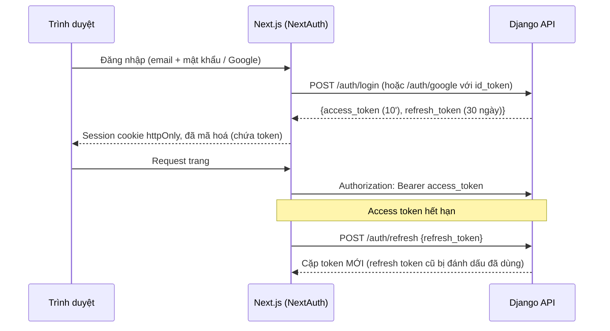

# 05. Xác thực và bảo mật

> Trạng thái: **Đã chốt cho MVP** ([quy ước](../../README.md#trạng-thái-tài-liệu)). Quyết định nền tảng: [ADR 0002](../adr/0002-auth-nextauth-session-django-jwt.md), [ADR 0009](../adr/0009-nextjs-bff-django-private.md).

## 1. Mô hình xác thực



Trình duyệt **không bao giờ** thấy token thô; chỉ server Next.js giữ token trong cookie đã mã hoá.

Vì vậy Next.js là BFF cho **mọi** request tới Django, kể cả request không cần đăng nhập (ADR 0009). Django chạy cùng VPC với Next.js và chỉ mở `/api/v1/webhooks/*` ra internet.

### 1.1. Hợp đồng bảo mật của BFF

**Cookie session**
- Production: host-only, `Path=/`, `HttpOnly`, `Secure`, `SameSite=Lax`; tên tách biệt `__Host-store-session` và `__Host-backoffice-session`. Không đặt `Domain` dùng chung cho hai ứng dụng.
- NextAuth và secret mã hoá session cấu hình riêng từng ứng dụng; không giải mã/chấp nhận cookie của ứng dụng còn lại.
- Local HTTP: tên không có tiền tố `__Host-`, secret và cấu hình local riêng; không hạ cấu hình production để chạy local.

**Không lộ token**
- Callback session chỉ trả hồ sơ tối thiểu và trạng thái đăng nhập; không trả access/refresh/lookup/quote token qua endpoint session hoặc props/HTML cho JavaScript.
- BFF chuyển token nó quản lý tới đúng header/endpoint của Django; response auth từ Django không được proxy nguyên dạng ra trình duyệt.
- Quote token checkout được trả trong API quote theo 04; đây là chứng từ có chữ ký, không phải token đăng nhập.

**CSRF / Origin**
- Browser → BFF dùng cookie nên mọi lệnh thay đổi dữ liệu, kể cả đăng nhập/đăng xuất, phải qua CSRF của framework hoặc token CSRF gắn session, đồng thời kiểm `Origin` khớp danh sách origin tường minh. Thiếu Origin hợp lệ hoặc CSRF token hợp lệ thì từ chối.
- OAuth callback theo `state`/PKCE của NextAuth; không bỏ kiểm tra chỉ vì callback là GET. GET thông thường không gây thay đổi nghiệp vụ.

**Header**
- BFF không chuyển tiếp `Authorization`, `X-Lookup-Token`, `X-BFF-Secret`, `X-Client-IP`, `X-Request-ID` do browser gửi làm nguồn tin cậy.
- BFF dựng lại header auth từ session đã xác minh, header IP theo mục 5 và tự sinh `X-Request-ID` mỗi request (Django tin `X-Request-ID` khi secret đúng, nên giá trị browser chọn không được lọt qua — [10](./10-nfr.md) mục 4).
- `X-BFF-Secret` là secret giữa hai server, không phải CSRF token, không gửi ra browser.

**Logout**
- BFF yêu cầu Django thu hồi family rồi xoá session cookie tương ứng.
- Django tạm không truy cập được: vẫn xoá cookie local, báo thu hồi phía server chưa xác nhận, không khôi phục cookie từ response refresh tới muộn.
- Không log token khi xử lý lỗi.

## 2. Thiết kế JWT

| Thuộc tính | Giá trị |
|---|---|
| Thuật toán | **EdDSA (Ed25519)**, khai báo cứng khi decode: `jwt.decode(token, key, algorithms=["EdDSA"], …)` |
| Khoá | Khoá bí mật chỉ ở Django (biến môi trường / Secrets Manager). Header có `kid` để thay khoá: giữ song song khoá cũ và mới trong thời gian bằng tuổi thọ refresh token |
| Access token | Sống **10 phút**. Claims bắt buộc: `iss`, `aud` (`store` hoặc `backoffice`), `sub` (UUID Account), `token_use = access`, `kind`, `tv` (integer không âm), `jti` (UUID), `iat`, `exp` |
| Refresh token | Sống **30 ngày** (storefront) / **12 giờ** (back-office). Claims bắt buộc: `iss`, `aud` (`store` hoặc `backoffice`), `sub` (UUID Account), `token_use = refresh`, `kind`, `tv`, `jti` (UUID), `fam` (UUID family), `iat`, `exp`. Bảng RefreshToken chỉ lưu sha256; ngoại lệ có kiểm soát là response mã hoá trong RefreshReplay để trả lại cùng kết quả trong 10 giây (mục 2.1) |
| Kiểm tra bắt buộc | Header `alg = EdDSA`, `kid` thuộc keyring cấu hình; claims bắt buộc phải tồn tại và đúng kiểu, `iss` bằng issuer cấu hình, `aud` đúng endpoint, `token_use` đúng mục đích, `iat <= exp`, chưa hết hạn/không phát hành trong tương lai quá leeway. Account phải còn active, `tv` và `kind` khớp trạng thái xác thực theo mục 2.2 |
| Lệch giờ cho phép | 30 giây |
| `lookup_token` | JWT ký bằng cùng khoá Ed25519, claims bắt buộc `iss`, `aud = order_lookup`, `sub` = Mã đơn, `token_use = lookup`, `iat`, `exp`; sống **30 phút**, không lưu DB và không thu hồi sớm được. Do `POST store/checkout` (Khách vãng lai) và `POST store/orders/lookup` cấp, gửi qua header `X-Lookup-Token`. `IsOrderOwner` kiểm tra chữ ký, mục đích và Mã đơn khớp URL; không yêu cầu Account/tv/family cho token vãng lai |

**Ba validator riêng biệt, loại trừ nhau:**
- `JWTAuthentication` chỉ nhận `token_use=access`; endpoint refresh chỉ nhận `token_use=refresh` và xác minh hash/jti/family từ DB; validator lookup chỉ nhận `token_use=lookup`, `aud=order_lookup`.
- Cùng audience `store`/`backoffice` không cho refresh token dùng làm Bearer access token. Token sai loại bị từ chối, không thử lần lượt các validator.
- `kid` chỉ tra keyring nội bộ, không dùng URL/key do token cung cấp; không chấp nhận thuật toán khác từ header ([RFC 8725 mục 3.12](https://www.rfc-editor.org/rfc/rfc8725.html#section-3.12)).

**Lookup token:** dùng public API `identity.contracts.issue_order_lookup_token` / `verify_order_lookup_token`; ordering không import nội bộ auth của identity. DTO sau xác minh chỉ mang Mã đơn/hạn token; selector của ordering kiểm tra đơn tồn tại và quyền/thao tác còn hợp lệ. Không fallback sang `TimestampSigner`.

**`quote_token`** thuộc ordering, không phải token xác thực. Keyring `QUOTE_SIGNING_KEYS` riêng, độc lập JWT và session; chỉ backend giữ key, ký bằng key hiện hành, xác minh bằng các key còn hiệu lực, giữ key cũ ít nhất bằng `QUOTE_TTL`. Payload, binding, mã lỗi theo [04 mục 5.3](./04-api-contract.md#53-vòng-đời-quote_token).

### 2.1. Xoay vòng refresh token và phát hiện dùng lại

```
Đăng nhập        → cấp R1 (family F)
Refresh bằng R1  → R1.used_at = now, cấp R2 (family F)
Refresh bằng R2  → R2.used_at = now, cấp R3 (family F)
Refresh bằng R1 lần nữa ngoài cửa sổ 10 giây (R1 đã dùng!)
                 → coi như bị đánh cắp: thu hồi TOÀN BỘ family F
                   → kẻ gian và người dùng thật đều phải đăng nhập lại
```

Trong cửa sổ **10 giây** từ used_at, request lặp bằng R1 chỉ nhận lại **chính cặp token đã cấp**, không tạo R2 thứ hai và không kéo dài cửa sổ ([ADR 0014](../adr/0014-refresh-single-successor.md)).

- **Lần đầu:** trong transaction, khoá Account trước rồi RefreshToken của R1. Kiểm chữ ký/claims/hash, `account.is_active`, `token_version`, family chưa thu hồi — từ DB, không dựa cache tv. Tạo R2 + access token, đánh dấu R1.used_at, lưu successor_jti và RefreshReplay cùng transaction. Mọi token mới của một family phải đi qua đường này.
- **RefreshReplay:** response mã hoá bằng AESGCM của thư viện cryptography; `expires_at = used_at + 10 giây`, `encryption_key_id`, nonce ngẫu nhiên 12 byte mới mỗi lần encrypt. Key 32 byte độc lập khoá ký JWT; associated data gắn parent_jti, family_id, aud. Không tự viết thuật toán mật mã, không log response/nonce cùng secret ([API AEAD của cryptography](https://cryptography.io/en/latest/hazmat/primitives/aead/)).
- **Lặp trong cửa sổ, R2 chưa dùng/chưa thu hồi:** kiểm lại các điều kiện trên rồi giải mã trả đúng response cũ; không làm mới hạn replay.
- **Lặp trong cửa sổ, R2 đã cấp R3:** trả 409 REFRESH_SUPERSEDED, không trả token cũ, không thu hồi nhầm family. BFF không ghi đè cặp token mới hơn bằng response cũ.
- **Dùng lại R1 ngoài cửa sổ:** thu hồi family.
- Logout, đổi mật khẩu, vô hiệu hoá, ẩn danh: khoá Account trước rồi token, xoá/vô hiệu mọi replay liên quan; replay không được khôi phục phiên đã thu hồi.
- Mất/hỏng ciphertext hoặc thiếu key trong cửa sổ: trả lỗi tạm thời, không cấp nhánh token khác.
- Job purge_refresh_replays mỗi phút xoá bản ghi hết hạn; kiểm `expires_at` luôn trước decrypt dù job chưa chạy. Không audit ciphertext; không đưa token vào sự kiện. Backup có thể còn ciphertext cũ, nhưng vẫn bắt buộc kiểm hạn replay và trạng thái thu hồi.
- **BFF single-flight:** một lần refresh đang chạy cho mỗi phiên/aud; nhiều replica dùng bộ điều phối chung, không chỉ biến trong bộ nhớ; khoá điều phối là ID phiên hoặc hash token, không token thô. Backend vẫn bảo đảm một successor khi Redis/BFF coordinator lỗi; BFF xử lý retry/REFRESH_SUPERSEDED, không tự sinh cặp token hoặc ghi đè phiên mới bằng kết quả cũ.

### 2.2. Thu hồi và độ trễ hiệu lực

| Sự kiện | Cách thu hồi |
|---|---|
| Đổi / đặt lại mật khẩu | Tăng `token_version` → mọi access token cũ sai `tv`; thu hồi mọi refresh token |
| Admin vô hiệu hoá Staff | `is_active = false` + tăng `token_version` |
| Đăng xuất | Thu hồi family của refresh token hiện tại, vô hiệu replay và xoá cookie ở BFF. Không tăng tv toàn Tài khoản và không đăng xuất các family khác |
| Ẩn danh Tài khoản | Như vô hiệu hoá |
| Đăng nhập Google vào Tài khoản chưa xác thực email | Như đổi mật khẩu (mục 3) |

Trạng thái auth gồm đúng `is_active`, `kind`, `token_version`. Claims không được tự quyết định quyền nếu không khớp trạng thái này. Chọn nguồn kiểm tra như sau:

| Nhóm request | Nguồn trạng thái auth |
|---|---|
| Mọi endpoint back-office đã xác thực, kể cả GET | Đọc PostgreSQL mỗi request, không dùng cache auth |
| Storefront đã xác thực: mọi lệnh ghi và mọi đọc dữ liệu riêng (`me`, địa chỉ, Đơn hàng), checkout/quote, bắt đầu Thanh toán, huỷ, yêu cầu xoá, refresh/logout | Đọc PostgreSQL mỗi request; refresh/revoke dùng khoá Account → Token theo mục 2.1 |
| Đọc storefront không nhạy cảm, chỉ trả catalog công khai và không thay đổi dữ liệu | Có thể dùng snapshot auth cache tối đa 60 giây nếu cần xác minh phiên tuỳ chọn; không cần token để đọc dữ liệu công khai. Không mở rộng ngoại lệ này sang dữ liệu cá nhân |
| Khách vãng lai dùng lookup token | Xác minh chữ ký/type/audience/hạn và quyền của đúng Đơn hàng; không suy ra một Account từ lookup token |

**Cache auth (nếu dùng):**
- Lưu đủ ba field cùng `observed_at` (lấy ngay trước khi đọc DB) và `expires_at = observed_at + 60 giây`. TTL tính từ mốc đó: không tính lại từ lúc ghi, không gia hạn khi đọc, không làm mới snapshot cũ. Snapshot quá hạn trước lúc ghi thì bỏ, đọc DB lại.
- Sau commit thay đổi trạng thái thì xoá cache; xoá thất bại hoặc race reader ghi lại snapshot cũ vẫn chỉ sống tới hạn gốc.
- Redis lỗi/miss → đọc DB. DB không đọc được → request cần xác thực fail-closed (`503 AUTH_STATE_UNAVAILABLE`); catalog công khai vẫn có thể chạy nếu dependency của nó còn phục vụ.

**Độ trễ hiệu lực:**
- Vô hiệu Staff và thu hồi do đổi/reset mật khẩu/ẩn danh có hiệu lực với lần kiểm auth từ DB bắt đầu sau commit; request đã xác thực trước commit có thể đang chạy, không hứa rollback từ xa. Thao tác cần ngăn race (refresh, thay đổi danh tính) kiểm lại dưới khoá Account.
- Nhóm đọc không nhạy cảm được cache: chấp nhận trễ tối đa 60 giây kể cả khi Redis bình thường; không gọi là thu hồi tức thì.
- Logout một family chặn cấp access token mới từ family đó, nhưng access token đã cấp còn hợp lệ tới hết 10 phút nếu tv/is_active/kind không đổi (BFF đã xoá cookie nên không dùng tiếp). Không tuyên bố logout một phiên thu hồi mọi access token đã sao chép; muốn vô hiệu toàn Tài khoản phải tăng tv và thu hồi mọi family như bảng trên.

### 2.3. Tách storefront và back-office

- `aud = store` và `aud = backoffice` khác nhau; token của storefront **không** dùng được cho back-office và ngược lại.
- Tài khoản `kind = customer` không đăng nhập được back-office; Staff/Admin không đăng nhập được storefront.
- Mỗi email thuộc tối đa một Tài khoản, với mọi `kind` (`UNIQUE(lower(email))`). Staff muốn mua hàng phải đăng ký Tài khoản Khách hàng bằng email khác. Đăng nhập storefront (kể cả Google) bằng email của Staff/Admin trả lỗi chung như sai thông tin đăng nhập.

## 3. Mật khẩu và đăng nhập

| Biện pháp | Chi tiết |
|---|---|
| Hash | Argon2id (`Argon2PasswordHasher` đứng đầu `PASSWORD_HASHERS`) |
| Độ mạnh | Tối thiểu 8 ký tự, kiểm tra bằng các validator có sẵn của Django (giống thông tin cá nhân, mật khẩu phổ biến, toàn số) |
| Chống dò | Đăng nhập: tối đa 5 lần sai / cửa sổ trượt 15 phút theo email chuẩn hoá và 20 lần sai / 15 phút theo IP tin cậy; chạm một trong hai ngưỡng thì lần thử tiếp theo trả `429` với `Retry-After`. Ghi nhận cả email không tồn tại và sai kênh/kind như thất bại, thông báo lỗi chung; cách đếm và concurrency theo mục 5 |
| Đăng ký | Luôn trả `202 AcceptedDTO` như nhau. Email mới: tạo Account chưa xác thực và phát `CustomerRegisteredV1`. Email đã có: không tạo Account, không đổi mật khẩu; Khách hàng chưa xác thực thì phát `VerificationEmailRequestedV1`, còn lại phát `RegistrationAttemptedV1` để báo cho chủ email (US-501 AC2). Thời gian xử lý hai nhánh không được chênh lệch tới mức đo được: nhánh email đã có vẫn băm mật khẩu như nhánh tạo mới |
| Đặt lại mật khẩu | Token ngẫu nhiên dùng một lần, lưu dạng hash, hết hạn 1 giờ. Token được sinh lúc gửi email (`identity.contracts.issue_password_reset_link`), không bao giờ nằm trong payload sự kiện. Email xác thực làm tương tự (`issue_email_verification_link`) |
| Google | Xác minh `id_token` bằng `google-auth`: chữ ký, `aud` = client ID của dự án, `iss`, `exp`, `email_verified = true` |
| Liên kết Google | Liên kết theo email. Nếu Tài khoản khớp có `email_verified = false` (có thể do kẻ gian đăng ký trước bằng email của nạn nhân, kèm mật khẩu của kẻ gian): đánh dấu đã xác thực, `set_unusable_password`, tăng `token_version`, thu hồi mọi refresh token |

Đăng nhập Google lần đầu có tạo Account mới vẫn là đăng ký theo CMP-01: GoogleInput có thể mang consents, service bắt buộc data_processing granted=true và phiên bản chính sách hiện hành trước khi tạo Account/cấp token, ghi Consent `channel = register` cùng transaction. Thiếu trả `422 DATA_PROCESSING_CONSENT_REQUIRED`; không tự suy sự đồng ý với cửa hàng từ việc đồng ý đăng nhập Google. Account đã tồn tại không phải đăng ký lại; liên kết/takeover vẫn theo bảng trên.

## 4. Phân quyền

| Permission class | Nằm ở | Điều kiện |
|---|---|---|
| `IsCustomer` | `common/api/permissions.py` | `kind = customer` và `aud = store` |
| `IsStaff` | `common/api/permissions.py` | `kind ∈ {staff, admin}` và `aud = backoffice` |
| `IsAdmin` | `common/api/permissions.py` | `kind = admin` và `aud = backoffice` |
| `IsOrderOwner` | `apps/ordering/api/permissions.py` (là nghiệp vụ của `ordering`, nên không đặt ở `common`) | Đơn thuộc Khách hàng đang đăng nhập, hoặc header `X-Lookup-Token` hợp lệ cho đúng đơn |

Mặc định của DRF là **từ chối** (`DEFAULT_PERMISSION_CLASSES = [IsAuthenticated]`); endpoint công khai phải khai báo rõ `AllowAny`. Mỗi endpoint back-office có test kiểm tra Staff/Admin/Customer/ẩn danh.

`DEFAULT_AUTHENTICATION_CLASSES` để rỗng (`[]`) có chủ đích: view back-office tự khai `authentication_classes = (JWTAuthentication,)` (audience `backoffice`), endpoint công khai như `auth/login` hay geo dùng mặc định rỗng (login khai rõ `()`). Như vậy Bearer back-office không bị gắn lên endpoint storefront, và token `store` sau này đi qua authenticator riêng. View back-office quên khai `authentication_classes` thì request không được xác thực và bị `IsStaff` chặn (403), không mở.

## 5. Giới hạn tần suất (throttling)

- Throttling DRF cho hạn mức request chung, lưu Redis. Built-in throttle dùng thao tác cache không atomic nên chỉ là giới hạn gần đúng, không bảo đảm chống brute force tuyệt đối ([tài liệu DRF](https://www.django-rest-framework.org/api-guide/throttling/)).
- Hạn mức đăng nhập sai (mục 3) dùng failure ledger Redis riêng, check/reserve/ghi kết quả atomic bằng Lua/script được kiểm thử; không coi `ScopedRateThrottle` đếm mọi request là bộ đếm lần sai.

**Failure ledger:**
- Timestamp của cửa sổ trượt 15 phút; ID suất `uuid4` mới cho mỗi lần thử để hoàn tất một lần (không dùng `X-Request-ID` vì id BFF gửi có thể lặp, làm failure ghi đè nhau).
- Key là HMAC (`common.privacy.pii_hmac`, keyring `PII_HMAC_KEYS`, [ADR 0016](../adr/0016-erasure-evidence-phone-hmac.md)) của email sau trim/lowercase hoặc IP đã chuẩn hoá; không đưa email/IP thô vào tên key/log.
- Kiểm và giữ suất trước khi thử mật khẩu để request đồng thời không cùng vượt ngưỡng. Sai → suất thành một failure; thành công → trả suất và xoá failure email trước lần thành công đó, không xoá lịch sử IP. Lỗi giữa chừng (500) → trả suất, không ghi failure. Không ghi nhiều failure cho cùng request.
- Suất chờ có hạn theo ngân sách timeout đăng nhập, được thu hồi khi worker chết.
- `Retry-After` chỉ tính trên chiều (email hoặc IP) đang chạm ngưỡng: thời điểm số failure + suất của chiều đó tụt dưới hạn mức.
- Redis lỗi hoặc treo (timeout client ngắn): throttle và failure ledger **fail-open**, vẫn dùng lỗi đăng nhập chung, phát metric cảnh báo không chứa định danh (nguồn: event log `login_failure_ledger_unavailable` kèm `operation`); WAF trên CloudFront vẫn chặn thô. Đây là đánh đổi tính sẵn sàng đã chọn, không hứa hạn mức chính xác khi Redis không hoạt động.

**IP của người dùng.** Mọi request đi qua Next.js nên Django thấy IP của Next.js; throttle theo IP nguồn sẽ làm mọi Người mua dùng chung hạn mức. Cách xử lý:

- Next.js loại `X-Client-IP`, `X-BFF-Secret` và mọi Authorization/lookup header do browser gửi; dựng lại header từ session và IP từ chuỗi proxy tin cậy.
- Chỉ tin header nguồn do CloudFront/ALB cấu hình ghi đè; xác định số hop/địa chỉ proxy tin cậy theo môi trường, không lấy phần tử trái nhất của `X-Forwarded-For` tuỳ ý. Kiểm định dạng IPv4/IPv6; không có nguồn tin cậy thì dùng peer của BFF hoặc từ chối trường IP, không truyền chuỗi client khai báo.
- Next.js gửi IP trong `X-Client-IP`, kèm `X-BFF-Secret` = biến môi trường `BFF_SHARED_SECRET`. Trước go-live phải test toàn đường browser → edge → BFF → Django với header giả, không chỉ unit test Django so secret.
- Middleware Django chỉ tin `X-Client-IP` khi `X-BFF-Secret` đúng (`hmac.compare_digest`); sai/thiếu thì dùng IP nguồn.
- `BFF_SHARED_SECRET` nhận tối đa hai giá trị cách nhau dấu phẩy để xoay không gián đoạn: thêm secret mới vào Django, đổi Next.js, rồi bỏ secret cũ ([09](./09-deployment-aws-target.md)).
- Mọi throttle "theo IP" dùng giá trị đã xác minh này. Log ứng dụng dùng định danh IP HMAC (`common.privacy.pii_hmac`) khi cần tương quan, không ghi IP thô hoặc toàn bộ proxy headers vào log nghiệp vụ.

| Scope | Giới hạn **[Giả định · kiểm chứng: tỉ lệ `429` của người dùng thật trong tháng đầu production]** |
|---|---|
| Ẩn danh, mặc định | 120 request / phút / IP |
| Đã đăng nhập, mặc định | 300 request / phút / Tài khoản |
| `auth_login` | Như mục 3 |
| `auth_google` | 20 request / 15 phút / IP; đếm mọi lần gọi |
| Đăng ký, quên mật khẩu, gửi lại email xác thực | 3 request / giờ / email đã chuẩn hoá và 10 request / giờ / IP; đếm mọi lần gọi, phản hồi `202` không tiết lộ email tồn tại; khi bị throttle trả `429` cùng định dạng cho mọi email |
| Xác thực email, đặt lại mật khẩu | 20 request / 15 phút / IP; đếm mọi lần gọi, token sai/hết hạn có lỗi chung |
| `order_lookup` | 10 lần / 15 phút / IP |
| `checkout` | 10 lần / phút / Tài khoản hoặc cart token, và 30 lần / phút / IP (Khách vãng lai đổi được cart token tuỳ ý) |
| Webhook | Không throttle (đã xác thực bằng chữ ký) |

## 6. Webhook và tích hợp

**Chữ ký**
- Giới hạn kích thước body/query; parse đúng cấu trúc tối thiểu để dựng chuỗi ký của provider (không thể xác minh chữ ký trên field chưa parse; parse kỹ thuật không phải tin dữ liệu).
- Xác minh bằng `hmac.compare_digest` **trước khi tin nội dung, ghi nghiệp vụ hoặc phát sự kiện**.
- Từ chối field trùng/định dạng mơ hồ theo adapter; không sửa chuỗi ký bằng chuẩn hoá đầu vào nghiệp vụ.

**Lưu và ACK**
- Quan sát hợp lệ: lưu dữ liệu gốc vào `*_event`, tạo khoá chống trùng theo provider/quan sát, cập nhật Payment/Shipment cùng outbox trong một transaction.
- Chỉ ACK quan sát đã commit hoặc trùng đã commit; không ACK thành công khi DB rollback/chưa biết đã lưu.
- Chữ ký sai, không tìm thấy, dữ liệu lỗi, retry tạm thời có phản hồi riêng theo provider tại 06; webhook không dùng error envelope REST nếu provider đòi định dạng khác.

**Số tiền**
- `amount` của callback có chữ ký không tự chứng minh đã thu tiền. Adapter phân biệt success/captured, authorized, pending, failed, unknown theo sản phẩm tích hợp.
- Chỉ ghi `amount_received` và phát yêu cầu xử lý sai số tiền khi có bằng chứng tiền thực nhận đã xác minh; so với `payments_payment.amount` theo BR-PAY-04. Không tạo Hoàn tiền chỉ vì amount khác trên thông báo thất bại/chưa capture. DTO và bảng chuyển trạng thái theo 06.

**Return URL / redirect**
- Return URL chỉ để hiển thị, không bao giờ đổi trạng thái thanh toán.
- Backend dựng từ STOREFRONT_ORIGIN cấu hình + path cố định /payment/return; client không gửi return_url. Production: HTTPS, host/port allowlist tường minh; local: origin localhost cấu hình riêng. Không lấy origin từ Host/X-Forwarded-Host/request body.
- Query định tuyến chỉ chứa payment_id/order_code, không token hay PII; trang return đọc trạng thái đã xác thực qua API.
- return_url còn sót trong body → 400 INVALID_RETURN_URL, không âm thầm dùng.
- redirect_url của gateway phải qua parser và allowlist scheme/host đúng môi trường/adapter trước khi trả client; Fake Gateway có allowlist local riêng. Không kiểm host bằng startswith/endswith ([OWASP về redirect](https://cheatsheetseries.owasp.org/cheatsheets/Unvalidated_Redirects_and_Forwards_Cheat_Sheet.html)).

## 7. Bảo vệ ứng dụng

| Rủi ro (OWASP) | Biện pháp |
|---|---|
| Truy cập trái phép đối tượng (IDOR) | Selector luôn lọc theo chủ sở hữu; Khách vãng lai dùng `lookup_token` (header `X-Lookup-Token`) gắn với đúng một đơn. Mã đơn ngẫu nhiên nên không đoán được |
| Injection | Chỉ dùng ORM / query có tham số; cấm `raw()` với chuỗi ghép |
| Gán field ngoài ý muốn | Serializer liệt kê field tường minh, không dùng `fields = "__all__"` |
| Bề mặt public | Django chỉ mở `/api/v1/webhooks/*` ra internet; mọi API khác chỉ nhận request từ Next.js trong VPC (ADR 0009). Trình duyệt không gọi thẳng Django nên không cần CORS và không dùng `django-cors-headers` |
| CSRF | Đoạn BFF → Django chỉ dùng Bearer/lookup token, không dùng cookie session Django nên không yêu cầu Django CSRF cho API đó. Browser → BFF dùng cookie phải kiểm CSRF/Origin theo mục 1.1. Không dùng Django Admin ở mọi môi trường (ADR 0004), nên không có trang nào của Django dùng cookie session |
| Header bảo mật | `SECURE_HSTS_SECONDS`, `SECURE_CONTENT_TYPE_NOSNIFF`, `X_FRAME_OPTIONS = "DENY"`, `SECURE_PROXY_SSL_HEADER` sau ALB |
| Upload ảnh | Chỉ chấp nhận JPEG/PNG/WebP, kiểm tra bằng Pillow, giới hạn 5 MB, đặt `Image.MAX_IMAGE_PIXELS` để chặn decompression bomb, xoá EXIF (có thể chứa GPS), đổi tên file thành UUID |
| Secrets | Không commit `.env`; trên AWS dùng Secrets Manager |
| Phụ thuộc | `uv lock` + kiểm tra lỗ hổng (`pip-audit`) trong CI |

## 8. Dữ liệu cá nhân trong log

- Không log mật khẩu, token, chữ ký, toàn bộ IPN. Bộ lọc áp lên log ứng dụng, reverse proxy/edge và Sentry: loại `Authorization`, `Cookie`, `Set-Cookie`, `X-Lookup-Token`, `X-Cart-Token`, `X-BFF-Secret` và các body auth/quote chứa token. VNPay IPN là GET nên phải bỏ query string hoặc redact toàn bộ tham số nhạy cảm ở access log, không chỉ lọc JSON body.
- Payload sự kiện trong outbox không chứa secret hay PII, chỉ mang ID, Mã đơn và số tiền ([07-async-events-jobs.md](./07-async-events-jobs.md) mục 2), vì outbox giữ sự kiện 90 ngày và có thể bị phát lại.
- Không chủ động log email, số điện thoại, địa chỉ hoặc IP thô. Processor che key nhạy cảm chỉ là lưới an toàn; sự kiện hỗ trợ vận hành dùng ID, mã lỗi và định danh HMAC khi thật sự cần, không dùng chuỗi che một phần như nguồn dữ liệu nghiệp vụ.
- Sentry: bật `send_default_pii = False`, lọc toàn bộ header/token/body/query nhạy cảm nêu trên trước khi gửi, kể cả breadcrumbs và URL lỗi; không chỉ xoá header `Authorization`.
- Mỗi lần Staff xem chi tiết khách được ghi `identity_customer_data_access_log` (CMP-07).

## 9. Kiểm chứng

**JWT và loại token**
- Theo **OWASP JWT Cheat Sheet**: sai thuật toán, `alg: none`, sai `aud`, hết hạn, sai `kid`, dùng lại refresh token, đổi `token_version`. Bổ sung: thu hồi qua `jti`; token storefront không dùng được cho back-office.
- Bắt buộc token_use đúng access/refresh/lookup: refresh-as-Bearer, access-as-refresh, lookup-as-access, quote-as-auth và thiếu/sai loại bị từ chối kể cả đúng chữ ký/audience; thiếu claim bắt buộc, sai issuer, kid hoặc alg không fallback sang cơ chế khác.
- **JWT tra cứu đơn**: `aud` khác (ví dụ access token `store`), token của đơn khác, hết hạn, thiếu claim bắt buộc, sai iss/aud, sai thuật toán, kid không có trong keyring hoặc token kiểu TimestampSigner đều bị từ chối. Access/refresh không thay được lookup token; lookup token không đăng nhập được API tài khoản. Xác minh qua public contracts của identity, không import auth nội bộ từ ordering.

**Thu hồi và cache auth**
- Mọi request back-office và thao tác storefront nhạy cảm/private xác thực từ DB (is_active/kind/tv); token cũ bị từ chối sau commit đổi tv/vô hiệu; request trước commit được mô tả riêng. DB lỗi → 503 AUTH_STATE_UNAVAILABLE (fail-closed, không dùng cache); Redis lỗi → fallback DB.
- Mô phỏng race: A đọc phiên bản cũ → B commit đổi tv và invalidate → A ghi cache. TTL cứng tính từ `observed_at`, không trượt, không vượt `observed_at + 60 giây`; Redis hồi lại không làm cache sống thêm; nhóm đọc DB không bị ảnh hưởng.
- Không khẳng định logout một family thu hồi ngay mọi access token đã sao chép: access token cũ dùng được tới khi bị kiểm từ DB hoặc hết hạn (mục 2.2).

**Refresh rotation (mục 2.1)**
- **Một successor:** hai request đồng thời dùng R1 chỉ tạo R2 một lần; R1.used_at, successor_jti, ciphertext commit cùng transaction. Mất response rồi retry trong 10 giây nhận đúng cặp cũ, không gia hạn replay; Redis tắt vẫn không tạo nhánh mới.
- **Replay sau thu hồi:** logout/reset/Google takeover/ẩn danh/vô hiệu hoá giữa hai request → không trả token từ ciphertext; kiểm account/tv/family từ DB theo thứ tự khoá Account → Token; ciphertext liên quan bị vô hiệu/xoá.
- **R2 đã dùng:** R1 lặp trong cửa sổ trả REFRESH_SUPERSEDED, không thu hồi nhầm family hay trả token cũ; ngoài cửa sổ thu hồi family. Mất ciphertext/thiếu key không cấp successor thay thế.
- **Mã hoá:** key khác, AAD sai, ciphertext bị sửa đều không decrypt được. Từ chối replay hết hạn dù job purge chưa chạy; purge/revoke xoá ciphertext.
- **Purge/ẩn danh refresh-token family:** ORM purge ngắt successor và xoá replay rồi mới xoá token dưới khoá Account; family còn token hợp lệ không bị purge. Refresh/revoke đồng thời không tạo successor hoặc replay mồ côi.

**BFF boundary**
- Cookie store/back-office tách biệt, không dùng chéo; session JSON/endpoint không lộ token; Origin/CSRF sai không gọi lệnh Django; logout không bị refresh tới muộn khôi phục cookie.
- Browser giả `X-Client-IP`/`X-BFF-Secret`/`Authorization` bị ghi đè. `X-Client-IP` thiếu hoặc sai `X-BFF-Secret` thì bỏ qua, throttle theo IP nguồn.
- Multi-replica single-flight không dựa bộ nhớ một process; response cũ không ghi đè cặp mới hơn.

**Hạn mức (mục 5)**
- Cửa sổ trượt và boundary; email khác hoa thường cùng key; success chỉ xoá failures email cũ, IP còn giữ; request song song không vượt suất khi Redis hoạt động; timeout giải phóng suất; fail-open lúc Redis lỗi có metric.
- Không dùng test đơn luồng để khẳng định DRF throttle atomic tuyệt đối.

**Webhook và redirect**
- Payload/query lớn hoặc trùng field bị chặn; xác thực trước mutation; failed/authorized IPN không ghi tiền thực nhận; DB rollback không ACK; log/Sentry không giữ GET IPN query, token, secret.
- body gửi return_url bị từ chối; Host/Forwarded/Origin giả không đổi callback server dựng. Production chỉ HTTPS origin/path cố định; local origin riêng. redirect_url giả host, userinfo, scheme lạ hoặc host giống tiền tố bị chặn. Return page không xác nhận thanh toán từ query string. Đổi cấu hình origin giữa các retry không đổi URL trong creation_input đã lưu.

**Tài khoản**
- **Google đăng ký**: email mới thiếu consent xử lý dữ liệu → 422 DATA_PROCESSING_CONSENT_REQUIRED, chưa tạo Account/token; có consent hiện hành → tạo Account và Consent register cùng transaction. Email đã có Account không bị bắt đồng ý đăng ký lại hoặc ghi consent marketing ngoài ý muốn.
- **Đăng nhập Google vào Tài khoản chưa xác thực email** (chiếm tài khoản trước): đánh dấu đã xác thực, mật khẩu cũ không đăng nhập được, mọi refresh token cũ bị thu hồi, access token cũ sai `tv`.
- **Một email một Tài khoản**: đăng ký Khách hàng bằng email Staff bị từ chối; đăng nhập storefront bằng Tài khoản Staff (mật khẩu hoặc Google) bị từ chối với lỗi chung.

**Trước production**
- Rà soát theo **OWASP ASVS** chương xác thực và quản lý phiên trước khi lên production.
- Security review (nội bộ hoặc bên thứ ba) trước go-live.
