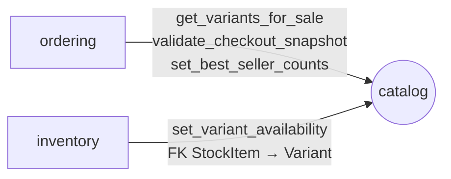

# Module `catalog`

> Trạng thái: **Đã chốt cho MVP**, code _(kế hoạch)_. Khuôn chung: [02 mục 4](../02-backend-structure.md#4-khuôn-mẫu-một-module).

## 1. Sở hữu

- Danh mục, Sản phẩm, Biến thể, ảnh theo màu, danh sách size và bảng màu, Giá bán, **Giá khuyến mãi** (đặt cùng Giá bán vì danh sách Sản phẩm lọc, sắp xếp theo Giá áp dụng).
- Bản sao để lọc, sắp xếp nhanh: còn/hết hàng của Biến thể, số liệu bán chạy.
- Lớp 3, chỉ phụ thuộc `common`; `inventory`, `ordering` gọi vào.

## 2. Cây thư mục

`models` là package (nhiều khái niệm độc lập); `services`, `selectors` là file.

```
apps/catalog/
├── apps.py                    # name = "apps.catalog", label = "catalog"
├── contracts.py               # mục 4.1
├── exceptions.py              # CheckoutSnapshotChanged…
├── constants.py               # trạng thái Sản phẩm, Biến thể
├── models/
│   ├── category.py            # Category (cây Danh mục)
│   ├── attributes.py          # Size, Color (danh sách dùng chung)
│   ├── product.py             # Product, ProductColor, ProductImage (ảnh theo màu)
│   ├── variant.py             # Variant
│   └── pricing.py             # SalePrice (Giá khuyến mãi)
├── services.py                # quản lý Sản phẩm, Biến thể, giá; mục 5.2
├── selectors.py               # danh sách, chi tiết, tìm kiếm, Giá áp dụng; mục 5.1
├── api/store/                 # danh sách, chi tiết Sản phẩm, Danh mục
├── api/backoffice/            # quản lý Sản phẩm, Biến thể, giá, size, màu
├── migrations/
└── tests/                     # soi gương cây ở trên; factories.py
```

## 3. Quan hệ với module khác



Không gọi module nào, chưa phát sự kiện.

## 4. Public API

### 4.1. `contracts.py`

| Hàm | Ai gọi | Ghi chú |
|---|---|---|
| `get_variants_for_sale(ids) -> list[VariantForSaleDTO]` | ordering | Giá áp dụng, `checkout_version`, mức giảm, snapshot tên/SKU, cân nặng. Gọi ngoài transaction |
| `validate_checkout_snapshot(snapshots)` | ordering | Trong transaction checkout: khoá mọi Variant theo id, kiểm lại phiên bản, giá, điều kiện bán; khác thì ném `CheckoutSnapshotChanged` (ordering chuyển thành `PriceChanged`) |
| `set_variant_availability(variant_id, available)` | inventory | Chỉ gọi khi còn/hết hàng thực sự đổi; chỉ ghi khi cần (mục 5.3) |
| `set_best_seller_counts(counts: dict[UUID, int])` | job hằng đêm của ordering | BR-CAT-12 |

### 4.2. `exceptions.py`

`CheckoutSnapshotChanged`: snapshot của checkout không còn khớp dữ liệu dưới khoá Variant.

## 5. Quy tắc riêng

### 5.1. Đọc và tìm kiếm

- Lọc theo mã size, mã màu; sắp xếp bán chạy theo `sold_30d`.
- Tìm chuỗi con trong tên, không dấu, không phân biệt hoa thường (BR-CAT-13) bằng `unaccent` + `pg_trgm`. Không tìm gần đúng.
- Giá áp dụng tính trong selector: Giá khuyến mãi nếu đang hiệu lực, ngược lại Giá bán.

### 5.2. Ghi

- Đổi Giá bán kiểm BR-PRC-05.
- Size, màu đã có Biến thể dùng chỉ ẩn được, không xoá (BR-CAT-11).
- Writer đổi dữ liệu ảnh hưởng checkout (giá, điều kiện bán): khoá Variant liên quan theo `id` tăng dần, tăng `checkout_version` ([13 mục 4](../13-python-django-coding-style.md#4-service-transaction-và-tác-vụ-bên-ngoài), [ADR 0012](../../adr/0012-checkout-price-snapshot.md)). Không gọi `inventory` khi đang giữ khoá Variant.

### 5.3. Bản sao còn/hết hàng

- `is_available` của Variant là bản sao từ `inventory`, chỉ để lọc nhanh.
- Checkout đã khoá đủ Variant trước khi gọi `set_variant_availability`; luồng tồn kho khác gom Variant cần cập nhật và khoá theo id.

## 6. Tài liệu liên quan

- Schema: [03 mục 3](../03-data-model.md#3-catalog)
- Snapshot giá khi checkout: [ADR 0012](../../adr/0012-checkout-price-snapshot.md), [`ordering` mục 5.1](./ordering.md#51-luồng-checkout)
- BR-CAT, BR-PRC: [business/04](../../business/04-business-rules.md)
