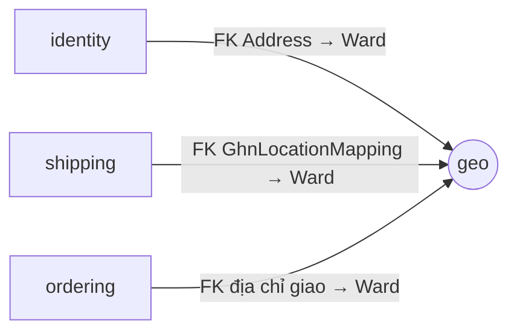

# Module `geo`

> Trạng thái: **Đã chốt cho MVP**, đã có code (đang nằm ở `shared/geo/`, chuyển sang `apps/geo/` theo [ADR 0018](../../adr/0018-one-django-app-per-module.md)). Khuôn chung: [02 mục 4](../02-backend-structure.md#4-khuôn-mẫu-một-module).

## 1. Sở hữu

Dữ liệu địa giới hành chính 2 cấp sau 07/2025: 34 tỉnh/thành và phường/xã. Đây là dữ liệu tham chiếu, chỉ đọc khi chạy; không có nghiệp vụ ghi.

`geo` ở lớp 2, dưới mọi module nghiệp vụ, vì `identity` (sổ địa chỉ), `shipping` (ánh xạ sang GHN) và `ordering` (địa chỉ giao của Đơn hàng) khai FK tới `Ward`.

## 2. Cây thư mục

```
apps/geo/
├── apps.py                    # name = "apps.geo", label = "geo"
├── models.py                  # Province, Ward (bảng geo_province, geo_ward)
├── selectors.py               # list_provinces, province_exists, list_wards
├── api/store/
│   ├── views.py               # ProvinceListView, WardListView
│   └── urls.py                # GET /api/v1/store/geo/provinces, provinces/{code}/wards
├── management/commands/
│   └── load_geo.py            # nạp dữ liệu từ package vietnam-provinces
├── migrations/
└── tests/                     # soi gương cây ở trên; factories.py (ProvinceFactory, WardFactory)
```

## 3. Quan hệ với module khác



`geo` không gọi module nào và không phát sự kiện.

## 4. Public API

Chưa có `contracts.py`, `events.py`, `exceptions.py`: module khác hiện chỉ khai FK tới `Ward` và truyền mã phường/xã dạng chuỗi. Thêm contract khi có module cần đọc tên hoặc kiểm tra mã.

## 5. Quy tắc riêng

- Dữ liệu chỉ nạp bằng lệnh `load_geo`: upsert theo mã trong một transaction, chạy lại không đổi gì. Mã không còn trong nguồn vẫn được giữ, vì còn là FK của địa chỉ và Đơn hàng. Không có API ghi.
- Khoá chính là mã Cục Thống kê (có số 0 đứng đầu), không kế thừa `BaseModel` ([ADR 0008](../../adr/0008-uuid-v7-primary-keys.md), ngoại lệ ở [03 mục 0.1](../03-data-model.md)).

## 6. Tài liệu liên quan

- Schema: [03 mục 1](../03-data-model.md#1-shared)
- Rủi ro địa chỉ 2 cấp và 3 cấp khi gọi GHN: [06](../06-integrations.md) mục 4
- Dữ liệu nguồn: package `vietnam-provinces` ([14](../14-dependencies.md))
