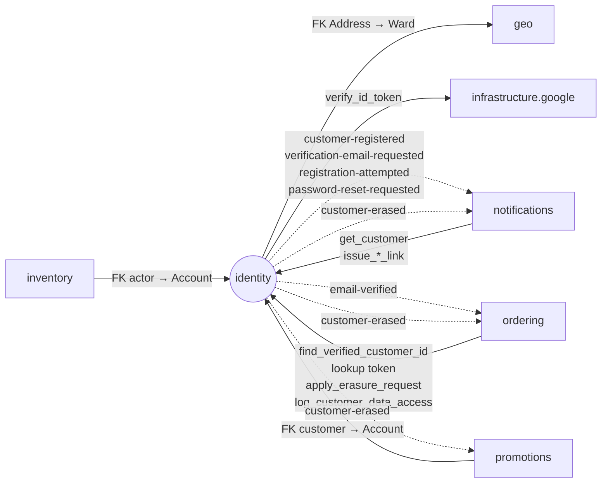

# Module `identity`

> Trạng thái: **Đã chốt cho MVP**, đã có code một phần (Tài khoản Staff/Admin, đăng nhập back-office). Mục đánh dấu _(kế hoạch)_ chưa có code. Khuôn chung: [02 mục 4](../02-backend-structure.md#4-khuôn-mẫu-một-module).

## 1. Sở hữu

Tài khoản (Khách hàng, Staff, Admin), xác thực bằng JWT, xác thực email, sổ địa chỉ, đồng ý xử lý dữ liệu và Yêu cầu xoá dữ liệu.

`identity` ở lớp 3. Chỉ phụ thuộc `geo` (FK địa chỉ) và `infrastructure.google`. `inventory`, `promotions`, `ordering`, `notifications` phụ thuộc vào nó.

## 2. Cây thư mục

`models` và `services` là package vì có nhiều khái niệm độc lập (Tài khoản, phiên đăng nhập, dữ liệu cá nhân).

```
apps/identity/
├── apps.py                    # name = "apps.identity", label = "identity"
├── contracts.py               # (kế hoạch) mục 4.1
├── events.py                  # (kế hoạch) mục 4.2
├── exceptions.py              # EmailAlreadyUsed, InvalidEmail, WeakPassword, InvalidCredentials…
├── constants.py               # AccountKind…
├── models/
│   ├── account.py             # Account (AUTH_USER_MODEL = "identity.Account")
│   ├── auth.py                # RefreshToken, RefreshReplay; AccountToken (kế hoạch)
│   ├── address.py             # (kế hoạch) Address, FK tới geo.Ward
│   └── privacy.py             # (kế hoạch) Consent, ErasureRequest, CustomerDataAccessLog
├── services/
│   ├── accounts.py            # create_staff_account; register, verify_email, update_profile (kế hoạch)
│   ├── auth.py                # login_backoffice; refresh, logout, reset mật khẩu, login_with_google (kế hoạch)
│   └── privacy.py             # (kế hoạch) record_consent, erase_customer, apply/finalize_erasure_request
├── auth/                      # adapter hạ tầng riêng của identity
│   ├── tokens.py              # phát hành, kiểm tra access/refresh/lookup JWT (Ed25519, kid)
│   ├── authentication.py      # JWTAuthentication cho DRF (back-office)
│   └── login_attempts.py      # failure ledger đăng nhập trên Redis
├── tasks.py                   # (kế hoạch) mục 5.4
├── api/
│   ├── backoffice/            # POST auth/login, GET auth/me
│   └── store/                 # (kế hoạch) đăng ký, đăng nhập, Google, hồ sơ, sổ địa chỉ
├── management/commands/
│   └── create_staff.py        # tạo Tài khoản Staff/Admin
├── migrations/                # migration đầu tiên phải có Account
└── tests/                     # soi gương cây ở trên; factories.py; concurrency/ (login ledger)
```

## 3. Quan hệ với module khác



## 4. Public API

### 4.1. `contracts.py` _(kế hoạch)_

| Hàm | Ai gọi | Ghi chú |
|---|---|---|
| `get_customer(id) -> CustomerDTO` | notifications | |
| `find_verified_customer_id(email) -> UUID \| None` | ordering | Checkout gắn đơn của Khách vãng lai vào Tài khoản đã xác thực (BR-ORD-08) |
| `issue_order_lookup_token(order_code) -> str`, `verify_order_lookup_token(token) -> OrderLookupDTO` | ordering | Mục 5.2 |
| `issue_email_verification_link(account_id) -> str`, `issue_password_reset_link(account_id) -> str` | notifications | Sinh token lúc gửi email, không lúc phát sự kiện |
| `record_consent(...)` | | |
| `get_erasure_subject(erasure_request_id) -> ErasureSubjectDTO` | handler của module khác | Lấy đối tượng cần ẩn danh |
| `apply_erasure_request(erasure_request_id)` | chỉ ordering | Sau khi ordering kiểm điều kiện CMP-05; ghi `processing` và phát sự kiện, chưa ghi `completed_at` |
| `log_customer_data_access(staff_id, customer_id, subject_phone, order_code, action)` | ordering | CMP-07 |

### 4.2. `events.py` _(kế hoạch)_

Payload chỉ mang `account_id` hoặc `erasure_request_id`, không mang token hay PII.

| Sự kiện | Phát khi |
|---|---|
| `CustomerRegisteredV1` | Đăng ký mới |
| `VerificationEmailRequestedV1` | Gửi lại email xác thực, hoặc đăng ký lại bằng email chưa xác thực |
| `RegistrationAttemptedV1` | Đăng ký bằng email đã có Tài khoản (US-501 AC2) |
| `EmailVerifiedV1` | Email chuyển sang đã xác thực, từ `verify_email` hoặc `login_with_google` |
| `PasswordResetRequestedV1` | Yêu cầu đặt lại mật khẩu |
| `CustomerErasedV1` | Yêu cầu xoá dữ liệu bắt đầu xử lý |

### 4.3. `exceptions.py`

`EmailAlreadyUsed`, `InvalidEmail`, `WeakPassword`, `InvalidCredentials`; thêm lỗi khi làm các luồng _(kế hoạch)_.

## 5. Quy tắc riêng

### 5.1. Tài khoản

- `Account` là custom user: email duy nhất cho mọi `kind` (một email là một Tài khoản), `kind` (`customer` / `staff` / `admin`), `language`, `token_version`, `is_active`, `email_verified`, `anonymized_at`. Model này phải nằm trong migration đầu tiên của `identity`.
- `create_staff_account` (lệnh `create_staff` và back-office US-1001) kiểm email, độ mạnh mật khẩu, email trùng.
- `update_profile` đổi họ tên, số điện thoại, ngôn ngữ; không đổi email.

### 5.2. Token và đăng nhập

- `auth/tokens.py` là hàm thuần, nhận `now` từ caller. Access/refresh/lookup token có validator loại trừ nhau ([05](../05-auth-security.md)).
- **Lookup token** cho tra cứu đơn: JWT Ed25519, bắt buộc `iss`, `aud = order_lookup`, `token_use = lookup`, `sub` (Mã đơn), `iat`, `exp` (30 phút), chỉ chấp nhận EdDSA và `kid` đã cấu hình. DTO chỉ trả Mã đơn và hạn token; `ordering` tự kiểm Mã đơn khớp URL. `identity` không truy vấn model Đơn hàng, `ordering` không import `identity.auth`.
- `JWTAuthentication` xác minh access token `aud = backoffice` rồi đọc `Account` từ PostgreSQL mỗi request. Khai theo từng view bằng `authentication_classes`; `DEFAULT_AUTHENTICATION_CLASSES` để rỗng ([05](../05-auth-security.md) mục 4).
- **Login ledger** (05 mục 5): `reserve`, `complete_failure`, `complete_success`, `release`; Lua atomic trên Redis, fail-open khi Redis lỗi.
- `RefreshToken` lưu `jti`, `family_id`, `token_hash`, `expires_at`, `used_at`, `successor_jti`, `revoked_at`; `RefreshReplay` giữ response mã hoá 10 giây ([ADR 0014](../../adr/0014-refresh-single-successor.md)). `AccountToken` dùng cho đặt lại mật khẩu và xác thực email, phân biệt bằng `purpose`, chỉ lưu hash.

### 5.3. Đăng nhập Google _(kế hoạch)_

`infrastructure.google` chỉ xác minh `id_token`. Phần nghiệp vụ nằm trong `services/auth.py`: khớp Tài khoản có `email_verified = false` thì đánh dấu đã xác thực, `set_unusable_password`, tăng `token_version`, thu hồi mọi refresh token. Tạo Tài khoản mới hoặc đánh dấu đã xác thực thì phát `EmailVerifiedV1`.

### 5.4. Dữ liệu cá nhân và job _(kế hoạch)_

- Job `reconcile_erasure_requests` (mỗi phút) gọi `finalize_erasure_request`: đối chiếu delivery của các handler bắt buộc qua `common.events`, hoàn tất yêu cầu `processing`. Khi hoàn tất, thay `subject_phone` bằng `subject_phone_hmac` trên ErasureRequest, Consent và CustomerDataAccessLog cùng transaction ([ADR 0016](../../adr/0016-erasure-evidence-phone-hmac.md)). Không truy vấn model của module khác. Hàm HMAC dùng chung là `common.security.privacy.pii_hmac`.
- Job `purge_refresh_replays` (mỗi phút) và `purge_expired_tokens` (hằng ngày) xoá dữ liệu token hết hạn.

## 6. Tài liệu liên quan

- Schema: [03 mục 2](../03-data-model.md#2-identity)
- Xác thực, JWT, BFF, throttle: [05](../05-auth-security.md); [ADR 0002](../../adr/0002-auth-nextauth-session-django-jwt.md), [ADR 0014](../../adr/0014-refresh-single-successor.md)
- Google OAuth: [06](../06-integrations.md) mục 5
- Ẩn danh dữ liệu: [03 mục 10](../03-data-model.md), [ADR 0016](../../adr/0016-erasure-evidence-phone-hmac.md)
