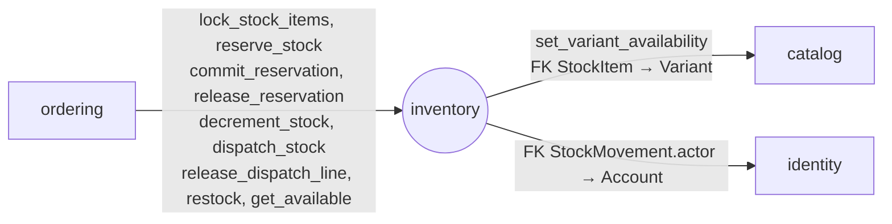

# Module `inventory`

> Trạng thái: **Đã chốt cho MVP**, code _(kế hoạch)_. Khuôn chung: [02 mục 4](../02-backend-structure.md#4-khuôn-mẫu-một-module).

## 1. Sở hữu

- Kho, Tồn kho, Giữ hàng, Hàng chờ xuất, Nhập kho, Kiểm kê, lịch sử thay đổi Tồn kho.
- Lớp 4: gọi `catalog` (bản sao còn/hết hàng), FK tới `Account` (người thực hiện). Chỉ `ordering` gọi vào.

## 2. Cây thư mục

Mọi model xoay quanh Tồn kho nên `models`, `services`, `selectors` đều là file.

```
apps/inventory/
├── apps.py                    # name = "apps.inventory", label = "inventory"
├── contracts.py               # mục 4.1
├── exceptions.py              # OutOfStock, ReservationExpired…
├── constants.py               # trạng thái Giữ hàng, Hàng chờ xuất; loại thay đổi Tồn kho
├── models.py                  # Warehouse, StockItem, StockReservation, DispatchLine, StockMovement
├── services.py                # mục 5
├── selectors.py               # Tồn kho, Số lượng bán được, lịch sử
├── api/backoffice/            # Nhập kho, điều chỉnh, Kiểm kê, xem Tồn kho
├── migrations/
└── tests/                     # soi gương cây ở trên; factories.py; concurrency/ (Giữ hàng, trừ kho)
```

## 3. Quan hệ với module khác



Chưa phát sự kiện: `ordering` là bên gọi nên tự biết kết quả.

## 4. Public API

### 4.1. `contracts.py`

Hàm ghi chạy trong transaction của bên gọi, thành một phần của transaction đó. `reference` là Mã đơn (`str` ≤ 16). Hàm ghi nhận `reference` (trừ `restock`) idempotent theo `reference`: gọi lại trả kết quả cũ, không đổi `on_hand` lần nữa.

DTO:

- `StockLineDTO`: `variant_id: UUID`, `quantity: int > 0`. Danh sách `items` không trùng `variant_id`.
- `AvailabilityDTO`: `variant_id: UUID`, `available: int ≥ 0` (Số lượng bán được).

| Hàm | Khi nào | Ghi chú |
|---|---|---|
| `lock_stock_items(items: list[StockLineDTO]) -> None` | Checkout, trước khi kiểm giá | Chỉ khoá mọi StockItem theo `variant_id` tăng dần, không cập nhật `catalog` |
| `reserve_stock(reference: str, items: list[StockLineDTO], expires_at: datetime) -> None` | Checkout online | Giữ hàng; `expires_at` lấy từ `Order.expires_at`. Ném `OutOfStock` |
| `decrement_stock(reference: str, items: list[StockLineDTO]) -> None` | Checkout COD | Trừ Tồn kho, tạo `DispatchLine` `awaiting`. Ném `OutOfStock` |
| `commit_reservation(reference: str) -> None` | T3 | Còn hạn: chuyển thẳng sang Hàng chờ xuất. Quá hạn hoặc đã giải phóng: kiểm lại Số lượng bán được trong cùng khoá dòng; đủ thì giữ lại và chuyển, không đủ thì ném `ReservationExpired` |
| `release_reservation(reference: str) -> None` | Huỷ đơn chưa thanh toán (T4, T5) | Idempotent |
| `dispatch_stock(reference: str) -> None` | T10 | Vận đơn tạo xong, hết Hàng chờ xuất: `DispatchLine` → `dispatched`, giảm `awaiting_dispatch` |
| `release_dispatch_line(reference: str) -> None` | Huỷ trước khi Vận đơn tạo xong (T7, T9) | `DispatchLine` → `released`, trả số lượng về Tồn kho |
| `restock(reference: str, items: list[StockLineDTO], actor_id: UUID \| None) -> None` | Đổi trả được nhập lại, Hoàn hàng về Kho | **Không** idempotent: một đơn có thể nhập lại nhiều lần (nhiều Đổi trả). Bên gọi bảo đảm gọi đúng một lần bằng mốc ghi cùng transaction (`returned_to_warehouse_at`, trạng thái Đổi trả); `actor_id` là Staff xác nhận |
| `get_available(variant_ids: list[UUID]) -> list[AvailabilityDTO]` | Đọc | Không khoá; có thể còn trừ Giữ hàng đã quá hạn ([03 mục 4.2](../03-data-model.md#42-inventory_stock_item-tồn-kho-của-một-biến-thể-trong-một-kho)) |

### 4.2. `exceptions.py`

| Lỗi | Khi nào |
|---|---|
| `OutOfStock` (409 `OUT_OF_STOCK`) | Không đủ Số lượng bán được khi Giữ hàng hoặc trừ kho |
| `ReservationExpired` | T3 tới muộn và không còn đủ hàng |
| 409 `INSUFFICIENT_AVAILABLE` | Điều chỉnh giảm hoặc Kiểm kê vượt Số lượng bán được (BR-INV-11) |

## 5. Quy tắc riêng

- **Service:** `receive_stock` (Nhập kho, bắt buộc số phiếu nhập), `reserve_stock`, `commit_reservation`, `release_reservation`, `decrement_stock`, `dispatch_stock`, `release_dispatch_line`, `restock`, `adjust_stock`, `count_stock` (Kiểm kê).
- **Lịch sử:** mỗi service đổi `on_hand` ghi một `StockMovement` theo bảng ánh xạ ở [03 mục 4.5](../03-data-model.md#45-inventory_stock_movement-lịch-sử-thay-đổi-tồn-kho-br-inv-09).
- **Trừ kho khi bán:** `decrement_stock`, `commit_reservation` tạo `DispatchLine` theo `reference`; Hàng chờ xuất kết thúc khi Vận đơn tạo xong sau Bàn giao; hàng thực sự rời Kho khi shipper lấy hàng sau đó ([ADR 0010](../../adr/0010-stock-decremented-at-order-awaiting-dispatch.md)).
- **Giữ hàng hết hạn:** `reserve_stock`, `decrement_stock` khoá dòng `StockItem` rồi tự giải phóng Giữ hàng quá `expires_at` của dòng đó trước khi kiểm. Job huỷ đơn gọi lại `release_reservation` vẫn an toàn.
- **Khoá:** khoá mọi StockItem của thao tác bằng `select_for_update` theo `variant_id` trước khi chạm `catalog`. Checkout đã khoá đủ Variant để kiểm giá; luồng khác gom mọi Variant cần đổi availability, khoá theo id tăng dần rồi mới cập nhật.
- **Bản sao còn/hết hàng:** Số lượng bán được chuyển giữa 0 và > 0 thì gọi `catalog.contracts.set_variant_availability`.

## 6. Tài liệu liên quan

- Schema: [03 mục 4](../03-data-model.md#4-inventory)
- Quyết định: [ADR 0010](../../adr/0010-stock-decremented-at-order-awaiting-dispatch.md) (trừ kho khi bán), [ADR 0003](../../adr/0003-postgres-redis-celery.md) (Giữ hàng quá hạn coi là không hợp lệ dù job chưa kịp giải phóng)
- Thứ tự khoá: [13 mục 4](../13-python-django-coding-style.md#4-service-transaction-và-tác-vụ-bên-ngoài)
