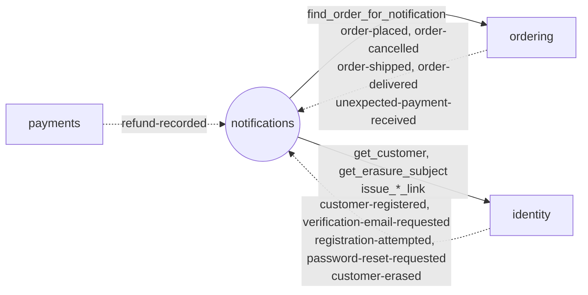

# Module `notifications`

> Trạng thái: **Đã chốt cho MVP**, code _(kế hoạch)_. Khuôn chung: [02 mục 4](../02-backend-structure.md#4-khuôn-mẫu-một-module).

## 1. Sở hữu

- Email gửi theo sự kiện, hàng đợi bền vững trong PostgreSQL (`EmailLog`).
- Lớp 6 (trên cùng): chỉ nghe sự kiện và đọc qua `contracts` của module khác; không module nào phụ thuộc vào nó.
- Gửi qua `EMAIL_BACKEND` của Django (Mailpit ở local, SES trên AWS), không có adapter riêng.

## 2. Cây thư mục

```
apps/notifications/
├── apps.py                    # name = "apps.notifications", label = "notifications"
├── constants.py               # trạng thái EmailLog, tên template
├── models.py                  # EmailLog
├── services.py                # tạo, claim, gửi, ghi kết quả EmailLog (mục 5.1)
├── handlers.py                # mỗi sự kiện cần email một handler (mục 5.2)
├── tasks.py                   # send_email, recover_pending_emails, purge_old_emails
├── templates/emails/          # template vi, en
├── management/commands/
│   └── retry_failed_emails.py # mở lại email lỗi được chọn
├── migrations/
└── tests/                     # soi gương cây ở trên; factories.py
```

## 3. Quan hệ với module khác



## 4. Public API

Không có `contracts.py`, không phát sự kiện: không module nào gọi vào.

## 5. Quy tắc riêng

### 5.1. Hàng đợi email

- `EmailLog` lưu sự kiện, ID nguồn để dựng nội dung, template, ngôn ngữ, người nhận; trạng thái `queued` / `sending` / `sent` / `failed` / `cancelled`, số lần thử, lịch retry và lease. `UNIQUE(event_id, template)`.
- Handler tạo EmailLog `queued` cùng transaction chuyển delivery sang `completed`, rồi đẩy `send_email(email_log_id)` qua `enqueue_on_commit`.
- Cấp link và gửi chỉ chạy trong task, ngoài transaction của consumer.
- Service claim bằng khoá dòng + lease trong transaction ngắn; lấy dữ liệu, cấp link, render, gửi ngoài transaction; chỉ ghi kết quả nếu lease token còn khớp ([07 mục 4](../07-async-events-jobs.md#4-email-hàng-đợi-bền-vững-trong-postgresql)).

### 5.2. Handler

| Sự kiện | Email |
|---|---|
| `identity.customer-registered`, `identity.verification-email-requested` | Xác thực email; link cấp lúc gửi qua `identity.contracts.issue_email_verification_link` |
| `identity.registration-attempted` | Báo chủ email có người vừa thử đăng ký, không kèm link hay mật khẩu |
| `identity.password-reset-requested` | Đặt lại mật khẩu; link cấp lúc gửi qua `issue_password_reset_link` |
| `identity.customer-erased` | Không gửi: lấy đối tượng qua `identity.contracts.get_erasure_subject`, ẩn danh `to_address` khớp `email`, huỷ email chưa gửi và vô hiệu lease |
| `ordering.order-placed` | COD: "Đặt đơn thành công"; online: "Thanh toán thành công" |
| `ordering.order-cancelled` | "Đơn đã huỷ", trừ khi `previous_status = PENDING_PAYMENT` (BR-NTF-01) |
| `ordering.order-shipped`, `ordering.order-delivered` | "Đang giao", "Đã giao" |
| `ordering.unexpected-payment-received` | Báo tiền sẽ được hoàn |
| `payments.refund-recorded` | "Đã hoàn tiền" |

Dữ liệu đơn lấy lúc gửi qua `ordering.contracts.find_order_for_notification`. Người nhận: email của Tài khoản (`identity.contracts.get_customer`) khi đơn có `customer_id`, ngược lại `contact_email`; rỗng hoặc Tài khoản đã ẩn danh thì EmailLog chuyển `cancelled`.

### 5.3. Job

| Task | Tần suất | Việc |
|---|---|---|
| `recover_pending_emails` | Mỗi phút | Đẩy lại EmailLog `queued` tới hạn hoặc `sending` hết lease |
| `purge_old_emails` | Hằng ngày | EmailLog `sent`, `failed`, `cancelled` tạo quá 90 ngày: xoá `to_address` và `context`, giữ dòng để thống kê |

Lệnh `retry_failed_emails` mở lại email lỗi được chọn; không gửi lại `sent` hay `cancelled`.

## 6. Tài liệu liên quan

- Schema: [03 mục 9](../03-data-model.md#9-notifications)
- Sự kiện, hàng đợi email: [07](../07-async-events-jobs.md) mục 2, 4
- Email (Mailpit, SES): [06](../06-integrations.md) mục 6
- Quy tắc gửi BR-NTF: [business/04](../../business/04-business-rules.md)
