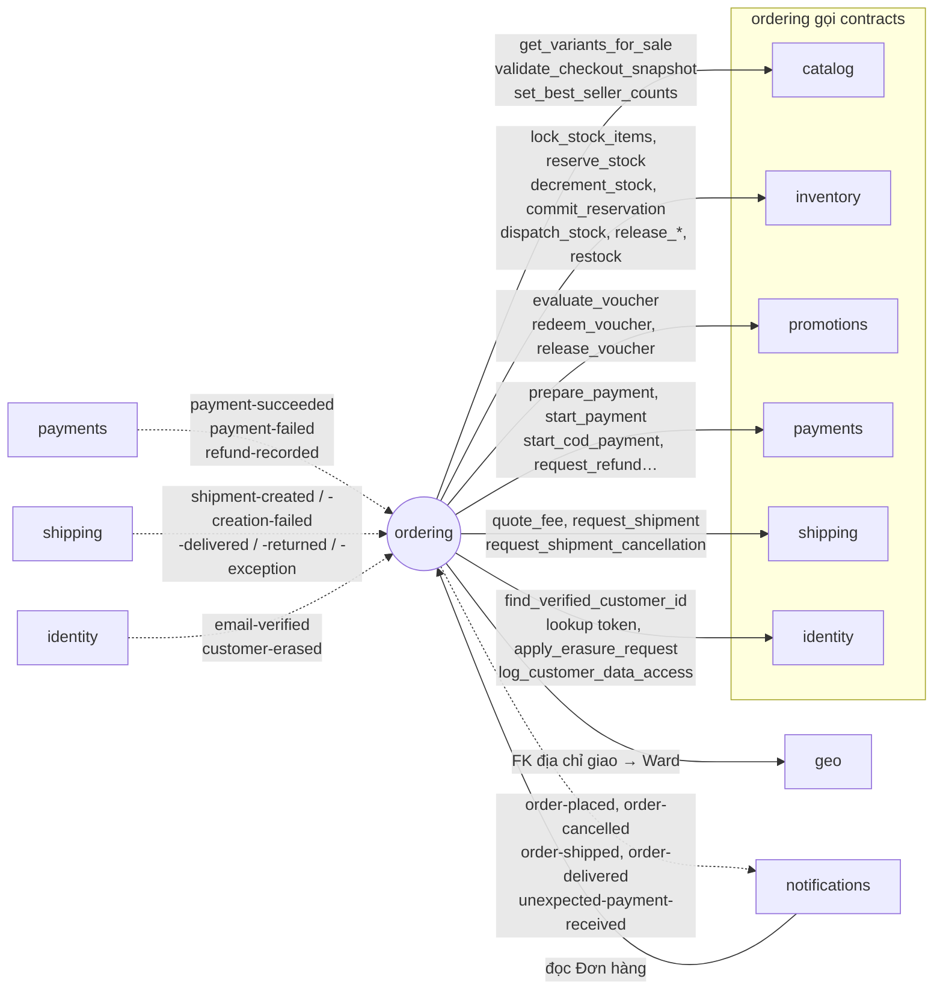

# Module `ordering`

> Trạng thái: **Đã chốt cho MVP**, code _(kế hoạch)_. Khuôn chung của module và quy tắc import: [02 mục 4](../02-backend-structure.md#4-khuôn-mẫu-một-module). Thuật ngữ theo [GLOSSARY.md](../../../GLOSSARY.md).

## 1. Sở hữu

Giỏ hàng, checkout, Đơn hàng và máy trạng thái của nó, Đổi trả, Cờ cần xử lý, cấu hình Ngưỡng miễn phí ship và Hạn mức COD.

`ordering` ở lớp 5: được gọi `contracts` của mọi module lớp dưới. Chỉ `notifications` (lớp 6) phụ thuộc vào nó.

## 2. Cây thư mục

`models`, `services`, `selectors` đều là package vì có nhiều khái niệm độc lập ([02 mục 4.2](../02-backend-structure.md#42-một-file-hay-một-package)).

```
apps/ordering/
├── apps.py               # name = "apps.ordering", label = "ordering"
├── contracts.py          # đọc dữ liệu Đơn hàng cho notifications
├── events.py             # OrderPlacedV1, OrderCancelledV1…
├── exceptions.py         # InvalidTransition, PriceChanged…
├── constants.py          # OrderStatus, PaymentMethod, OrderFlagKind, CancelReason;
│                         # RESERVATION_TTL, PAYMENT_LINK_TTL, PAYMENT_START_CUTOFF
├── models/
│   ├── cart.py           # Cart, CartItem
│   ├── order.py          # Order (máy trạng thái), OrderLine
│   ├── flags.py          # OrderFlag (Cờ cần xử lý)
│   ├── settings.py       # OrderingSettings (singleton)
│   └── returns.py        # ReturnRequest, ReturnLine
├── services/
│   ├── cart.py           # add_item, update_quantity, merge_guest_cart
│   ├── checkout.py       # place_order (mục 5.1)
│   ├── transitions.py    # mọi chuyển trạng thái của đơn đã tồn tại (mục 5.2)
│   ├── flags.py          # raise_flag, resolve_flag
│   ├── accounts.py       # attach_guest_orders, anonymize_orders, complete_erasure_request
│   └── returns.py        # record_return, receive_return_items, accept, reject, mark_refunded
├── selectors/
│   ├── cart.py           # get_cart_with_prices
│   └── orders.py         # list_orders_for_customer, find_order_for_guest, list_orders_backoffice
├── handlers.py           # nghe sự kiện của payments, shipping, identity (mục 5.6)
├── tasks.py              # job định kỳ (mục 5.7)
├── api/
│   ├── permissions.py    # IsOrderOwner
│   ├── store/            # giỏ, checkout, đơn của Người mua
│   └── backoffice/       # đơn, Cờ cần xử lý, Đổi trả, erasure-requests
├── migrations/
└── tests/                # soi gương cây ở trên (02 mục 4.4)
    ├── factories.py
    ├── services/test_checkout.py, test_transitions.py, test_returns.py…
    ├── test_handlers.py
    ├── api/store/test_views.py, api/backoffice/test_views.py
    └── concurrency/      # checkout và transition tranh chấp khoá
```

## 3. Quan hệ với module khác



Nét liền: gọi `contracts`. Nét đứt: sự kiện, chiều mũi tên là chiều phát → nghe.

## 4. Public API

### 4.1. `contracts.py`

Chỉ phục vụ `notifications`: đọc dữ liệu Đơn hàng để dựng email. Checkout và các transition **không** nằm ở đây, vì chỉ API của chính `ordering` gọi chúng.

### 4.2. `events.py`

| Sự kiện | Phát khi | Ghi chú |
|---|---|---|
| `OrderPlacedV1` | Đơn vào `PLACED`: COD ngay khi đặt (T2), online khi Thanh toán thành công (T3) | |
| `OrderCancelledV1` | Đơn bị huỷ | Có `previous_status`; `notifications` không gửi email khi là `PENDING_PAYMENT` |
| `OrderShippedV1` | T10 | |
| `OrderDeliveredV1` | T11 | |
| `UnexpectedPaymentReceivedV1` | Nhận khoản trả thêm hoặc tới sau khi huỷ | `notifications` báo tiền sẽ được hoàn |

### 4.3. `exceptions.py`

| Lỗi | Khi nào |
|---|---|
| `PriceChanged` (409 `PRICE_CHANGED`) | Checkout thấy giá, snapshot hoặc điều kiện bán khác `quote_token` |
| `PaymentWindowClosed` (`PAYMENT_WINDOW_CLOSED`) | Bắt đầu Thanh toán sau `PAYMENT_START_CUTOFF` |
| `InvalidTransition` | Transition mâu thuẫn với trạng thái đơn; consumer bỏ qua và ghi log |
| `TransitionNotYetValid` (kế thừa `RetryLater`) | Sự kiện tới sớm; consumer thử lại sau |
| `ShipmentInProgress` (409 `SHIPMENT_IN_PROGRESS`) | Staff huỷ đơn khi Vận đơn đang `requested` hoặc `creation_unknown` ([04](../04-api-contract.md) mục 3) |

Lỗi của module khác mà `ordering` bắt, không khai báo lại: `OutOfStock`, `ReservationExpired` (`inventory`), `VoucherNotApplicable` (`promotions`), `CheckoutSnapshotChanged` (`catalog`, chuyển thành `PriceChanged`).

## 5. Quy tắc riêng

### 5.1. Luồng checkout

Mục này là **nơi sở hữu** luồng checkout. Thứ tự khoá và quy tắc writer của catalog ở [13 mục 4](../13-python-django-coding-style.md#4-service-transaction-và-tác-vụ-bên-ngoài); vòng đời `quote_token` ở [04 mục 5.3](../04-api-contract.md#53-vòng-đời-quote_token).

`POST /api/v1/store/checkout`:

```
views.CheckoutView
  → serializers.CheckoutInput.validate()                 # payment_method, expected_total (MoneyDTO), quote_token
  → services.checkout.place_order(...)
       # 1. Replay idempotency completed sau kiểm quyền, trước khi bắt lỗi quote hết hạn;
       #    chưa có kết quả thì xác minh token, người mua, input
       # 2. Ngoài transaction: chưa giữ khoá nào khi gọi ra ngoài
       → catalog.contracts.get_variants_for_sale()        # Giá áp dụng, snapshot
       → promotions.contracts.evaluate_voucher()          # nếu có Voucher
       → shipping.contracts.quote_fee()                   # cache báo giá, GHN, hoặc Phí ship dự phòng
       → identity.contracts.find_verified_customer_id()   # Khách vãng lai trùng email đã xác thực thì gắn luôn (BR-ORD-08)
       → tính tổng, áp Ngưỡng miễn phí ship, kiểm tổng > 0 (BR-ORD-09), so với expected_total
                                                          # lệch → PriceChanged
       # 3. Trong transaction.atomic, khoá theo thứ tự: Cart → Tồn kho → Biến thể → Voucher
       → khoá Cart, so fingerprint các dòng với hash đã ký trong quote_token
       → inventory.contracts.lock_stock_items(items)      # khoá mọi StockItem theo variant_id
       → catalog.contracts.validate_checkout_snapshot()   # khoá mọi Variant theo id, kiểm lại giá/điều kiện bán
       → inventory.contracts.reserve_stock(expires_at=…)  # online: Giữ hàng 15 phút
         hoặc inventory.contracts.decrement_stock()       # COD: trừ Tồn kho, ghi Hàng chờ xuất
       → promotions.contracts.redeem_voucher(quote, reference)
       → kiểm lại tổng > 0 và expected_total; sai thì rollback mọi thay đổi
       → tạo Order + OrderLine (voucher_discount), xoá dòng giỏ đã mua, lưu kết quả idempotency
       → COD: payments.contracts.start_cod_payment()     # lưu payment_id vào Order
              + common.events.publish(OrderPlacedV1(...))
         online: không phát sự kiện
  → serializers.OrderOutput(order).data                  # Khách vãng lai nhận lookup_token; Khách hàng nhận null
```

- Sau commit, đơn COD được relay đẩy `ordering.order-placed` và `notifications` gửi email "Đặt đơn thành công". Đơn online: Người mua gọi tiếp `POST /store/orders/{code}/payments`; `order-placed` chỉ phát khi Thanh toán thành công (T3).
- Giá chốt trong transaction, dưới khoá Variant, và so với báo giá Người mua đã xác nhận trong `quote_token`. Khác phiên bản, đơn giá, snapshot hoặc điều kiện bán thì rollback, dựng quote mới ngoài transaction và trả `409 PRICE_CHANGED`, kể cả khi tổng tình cờ không đổi ([ADR 0012](../../adr/0012-checkout-price-snapshot.md)).
- Không gọi GHN khi đang giữ khoá. Người mua xác nhận quote mới bằng token và Idempotency-Key mới. Không có bảng Quote.

### 5.2. Máy trạng thái và transition

`Order.status` dùng `django-fsm-2`, bao phủ T1–T14 trong [05-order-lifecycle.md](../../business/05-order-lifecycle.md). Checkout tạo đơn ở T1/T2; mọi chuyển trạng thái của đơn đã tồn tại chỉ được gọi từ `services/transitions.py`:

| Nguồn | Transition |
|---|---|
| Staff hoặc Người mua | `confirm`, `start_packing`, `hand_over`, `cancel` (T5, T7, T9, T14), `receive_returned_shipment` |
| Sự kiện (mục 5.6) | `mark_paid` (T3), `mark_shipped` (T10), `mark_delivered` (T11), `mark_returned` (T12) |
| Job | `complete` |

- **Khoá:** mọi transition khoá dòng Đơn hàng bằng `select_for_update` trước khi đọc trạng thái. Hai transition cùng lúc trên một đơn (ví dụ T5 và T3) chạy lần lượt; transition sau thấy trạng thái mới.
- **Transition do sự kiện** tự đối chiếu trạng thái hiện tại với sơ đồ ở 05-order-lifecycle mục 2, nên handler không tự kiểm thứ tự:
  - Đơn **đã ở hoặc đã qua** trạng thái đích: không làm gì (sự kiện trùng hoặc tới muộn).
  - Đơn **chưa tới** trạng thái nguồn nhưng còn đi tới được: ném `TransitionNotYetValid`.
  - Còn lại, ví dụ GHN báo đã giao khi đơn đã `RETURNED_TO_SENDER`: ném `InvalidTransition`.
  - Các tình huống có cách xử lý riêng (05-order-lifecycle mục 4.1, 4.5) được kiểm trước ba nhánh này.

### 5.3. Mã đơn, hạn thanh toán, cấu hình

- **Mã đơn:** `FS<YYMM>-` + 6 ký tự Crockford Base32 ngẫu nhiên, `UNIQUE`, trùng thì sinh lại. Không dùng sequence.
- **Hạn thanh toán:** `Order.expires_at` = lúc đặt + `RESERVATION_TTL` (15 phút), là nguồn duy nhất, truyền xuống `reserve_stock`. Link thanh toán của mọi lần thử hết hạn ở lúc đặt + `PAYMENT_LINK_TTL` (phút thứ 10). Từ lúc đặt + `PAYMENT_START_CUTOFF` (phút thứ 7) không bắt đầu Thanh toán mới được.
- **`payment_id`:** Order lưu id của khoản dùng để thanh toán đơn: COD từ T2, online tại T3 dưới khoá Order. Huỷ, Hoàn hàng, Đổi trả truyền id này vào `request_refund`; khoản trả thêm hoặc sai số tiền truyền `payment_id` từ sự kiện. Mỗi yêu cầu hoàn truyền `request_key` ổn định theo thao tác nguồn ([03 mục 6](../03-data-model.md#6-payments)).
- **Cấu hình:** `OrderingSettings` giữ Ngưỡng miễn phí ship và Hạn mức COD.

### 5.4. Cờ cần xử lý, Đổi trả, Hoàn hàng

- **Cờ cần xử lý:** `OrderFlag` bật từ handler hoặc service (`raise_flag`), Staff gỡ qua back-office (`resolve_flag`, có lịch sử). `raise_flag` gặp cờ cùng `kind` đang mở thì nối thêm vào `note`, không báo lỗi.
- **Đổi trả:** `accept` nhận `accepted_quantity` và `restock` cho từng dòng (BR-RET-08), khoá Order để tính số hoàn lũy kế (BR-RET-07), gọi `inventory.contracts.restock` cho phần nhập lại. Tổng hoàn > 0 thì gọi `payments.contracts.request_refund`, lưu `refund_id` và chuyển `accepted`; tổng = 0 thì chuyển thẳng `refunded`, không tạo Refund. Mọi thay đổi commit cùng transaction.
- **Hoàn hàng:** T12 đặt `warehouse_return_required = true`. T14 chỉ đặt cờ này khi Staff xác nhận hàng chưa rời Kho; không tự cộng tồn khi huỷ. `receive_returned_shipment` khoá Order, chỉ nhận đơn có cờ và ở `RETURNED_TO_SENDER` hoặc `CANCELLED`; chưa có `returned_to_warehouse_at` thì gọi `inventory.contracts.restock` và ghi mốc cùng transaction. Gọi lại trả kết quả cũ, không nhập kho lần nữa, không đổi trạng thái đơn (BR-INV-08, US-607).

### 5.5. Dữ liệu cá nhân

- **Xoá dữ liệu:** `complete_erasure_request` kiểm tra điều kiện CMP-05 (đơn ở trạng thái cuối, `payments.contracts.has_pending_refunds`) rồi gọi `identity.contracts.apply_erasure_request`. Endpoint trả 202 khi chưa xong; job của `identity` ghi `completed_at` ([03 mục 10](../03-data-model.md)). Endpoint back-office `erasure-requests` nằm ở `ordering`.
- **Log truy cập:** chi tiết đơn và tìm đơn theo số điện thoại ở back-office gọi `identity.contracts.log_customer_data_access` (CMP-07).
- **`IsOrderOwner`:** JWT của Khách hàng chủ đơn, hoặc `X-Lookup-Token` xác minh qua `identity.contracts.verify_order_lookup_token`, kiểm `sub` khớp Mã đơn trên URL ([05 mục 2](../05-auth-security.md)).

### 5.6. Handler

Mỗi handler gọi **một** service; việc gọi `contracts` của module khác nằm trong service.

| Sự kiện | Service | Hành vi |
|---|---|---|
| `payments.payment-succeeded` | `mark_paid` | T3, lưu `payment_id`. Đơn còn `PENDING_PAYMENT` nhưng quá `expires_at` thì thử `commit_reservation`; gặp `ReservationExpired` mới chạy T4 rồi xử lý như đơn đã huỷ. Cùng `payment_id` đã gắn thì bỏ qua; khoản trả thêm hoặc tới sau huỷ thì Hoàn tiền + cờ `unexpected_payment` + phát `UnexpectedPaymentReceivedV1` (BR-PAY-05) |
| `payments.payment-failed` | — | `amount_mismatch`: `request_refund` đúng `amount_received` + cờ `payment_amount_mismatch` (BR-PAY-04) |
| `payments.refund-recorded` | `mark_refunded` | Đổi trả có `refund_id` khớp → `refunded`; không khớp thì bỏ qua |
| `shipping.shipment-created` | `mark_shipped` | T10, gọi `inventory.contracts.dispatch_stock`; đơn đã huỷ thì `request_shipment_cancellation` + cờ `shipment_after_cancel` |
| `shipping.shipment-creation-failed` | `raise_flag` | Cờ `shipment_failed` |
| `shipping.shipment-delivered` | `mark_delivered` | T11; COD gọi `payments.contracts.record_cod_collected` |
| `shipping.shipment-returned` | `mark_returned` | T12 |
| `shipping.shipment-exception` | `raise_flag` | Cờ `shipment_exception`; đơn giữ `SHIPPING` tới khi Staff xử lý (T14) |
| `identity.email-verified` | `attach_guest_orders` | Gắn đơn của Khách vãng lai cùng email |
| `identity.customer-erased` | `anonymize_orders` | Ẩn danh đơn; gọi `redact_provider_payloads` của `shipping`, `payments` |

### 5.7. Job định kỳ

| Task | Việc |
|---|---|
| `cancel_expired_pending_orders` | T4: huỷ đơn online quá `expires_at`; bỏ lượt khi delivery sự kiện đang trễ |
| `complete_delivered_orders` | T13: chuyển đơn đủ điều kiện sang Hoàn tất |
| `purge_expired_guest_carts` | Xoá Giỏ hàng đã hết hạn (BR-CRT-02) |
| `compute_best_sellers` | Hằng đêm tính BR-CAT-12, gọi `catalog.contracts.set_best_seller_counts` |

Lịch chạy và điều kiện bỏ lượt ở [07](../07-async-events-jobs.md) mục 3.

## 6. Tài liệu liên quan

- Schema: [03 mục 8](../03-data-model.md#8-ordering) (bảng `ordering_*`)
- Vòng đời Đơn hàng T1–T14: [business/05-order-lifecycle.md](../../business/05-order-lifecycle.md)
- API: [04](../04-api-contract.md) mục 5 (checkout, `quote_token`)
- Sự kiện, consumer, retry: [07](../07-async-events-jobs.md)
- Quyết định: [ADR 0010](../../adr/0010-stock-decremented-at-order-awaiting-dispatch.md) (trừ kho khi đặt), [ADR 0012](../../adr/0012-checkout-price-snapshot.md) (snapshot giá)
