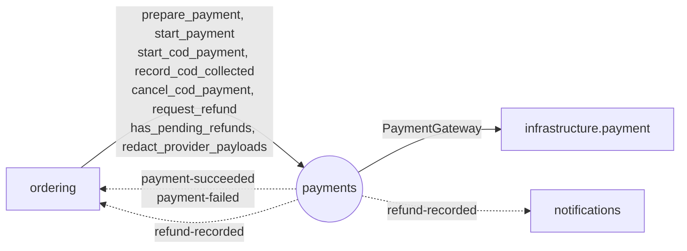

# Module `payments`

> Trạng thái: **Đã chốt cho MVP**, code _(kế hoạch)_. Khuôn chung: [02 mục 4](../02-backend-structure.md#4-khuôn-mẫu-một-module).

## 1. Sở hữu

- Thanh toán online (VNPay, MoMo) và COD, IPN, Hoàn tiền, Đối soát với Cổng thanh toán.
- Lớp 3, **không biết gì về Đơn hàng**: chỉ dùng `reference` (Mã đơn), báo kết quả bằng sự kiện, nên `ordering` gọi được khi checkout mà không tạo vòng phụ thuộc.
- Code gọi API cổng ở `infrastructure/payment/`.

## 2. Cây thư mục

```
apps/payments/
├── apps.py                    # name = "apps.payments", label = "payments"
├── contracts.py               # mục 4.1
├── events.py                  # mục 4.2
├── exceptions.py              # RefundRequestConflict, RefundAmountExceeded…
├── constants.py               # PaymentMethod (re-export qua contracts), Gateway, PaymentStatus, RefundChannel…
├── models.py                  # Payment, PaymentEvent (IPN gốc), Refund
├── services.py                # khởi tạo, ghi IPN, COD, Hoàn tiền; record_refund
├── tasks.py                   # mục 5.3
├── api/
│   ├── webhooks/              # GET /api/v1/webhooks/vnpay/ipn, POST /momo/ipn
│   ├── backoffice/            # ghi nhận Hoàn tiền đã làm tay (US-605)
│   └── dev/                   # trang Fake Gateway; chỉ đăng ký URL khi FAKE_PROVIDERS_ENABLED
├── migrations/
└── tests/                     # soi gương cây ở trên; factories.py

infrastructure/payment/        # không phải module; chỉ payments được import
├── base.py                    # interface PaymentGateway: create_payment_url, verify_ipn, query_transaction
├── vnpay.py                   # ký HMAC-SHA512
├── momo.py                    # ký HMAC-SHA256
└── fake.py                    # Fake Gateway cho local và test (ADR 0005)
```

## 3. Quan hệ với module khác



## 4. Public API

### 4.1. `contracts.py`

Xuất kèm enum `PaymentMethod` (`cod` / `online`) và `Gateway` (`vnpay` / `momo`); `ordering` dùng lại, không khai báo bản riêng. `reference` là Mã đơn, `amount` là `int` VND > 0.

`PaymentStartDTO`: `payment_id: UUID`, `state: ready | initializing | terminal`, `payment_status: PaymentStatus`, `code: str | None`, `redirect_url: str | None`; ràng buộc theo trạng thái ở [04 mục 5.2](../04-api-contract.md#52-schema-dùng-chung-và-checkout).

| Hàm | Ghi chú |
|---|---|
| `prepare_payment(reference: str, amount: int, gateway: Gateway, expires_at: datetime, operation_id: UUID) -> UUID` | Chỉ ghi DB: dựng `return_url` từ cấu hình backend, lưu snapshot. Gọi trong transaction ordering đã kiểm Order; `operation_id` đã có thì trả `payment_id` cũ |
| `start_payment(payment_id: UUID, operation_id: UUID) -> PaymentStartDTO` | Điều phối HTTP **ngoài** transaction bên gọi; kết quả `ready` / `initializing` / `terminal`, lease và khôi phục trên cùng Payment ([06](../06-integrations.md) mục 3.1, [ADR 0013](../../adr/0013-recoverable-payment-initiation.md)) |
| `start_cod_payment(reference: str, amount: int) -> UUID` | Trả `payment_id`. Gọi trong transaction checkout |
| `record_cod_collected(reference: str) -> None`, `cancel_cod_payment(reference: str) -> None` | Không phát sự kiện, vì `ordering` là bên gọi |
| `request_refund(payment_id: UUID, amount: int, reason: str, channel: RefundChannel, request_key: str) -> UUID` | Trả `refund_id`. Chỉ ghi Hoàn tiền `requested` cho Staff xử lý tay, không gọi cổng, nên gọi trong transaction (kể cả handler) an toàn |
| `has_pending_refunds(references: list[str]) -> bool` | Điều kiện của Yêu cầu xoá dữ liệu |
| `redact_provider_payloads(reference: str) -> None` | Ẩn danh dữ liệu IPN gốc |

### 4.2. `events.py`

| Sự kiện | `event_type` | Payload | Ghi chú |
|---|---|---|---|
| `PaymentSucceededV1` | `payments.payment-succeeded` | `reference: str`, `payment_id: UUID`, `amount: int`, `gateway: Gateway` | Chỉ phát cho Thanh toán online |
| `PaymentFailedV1` | `payments.payment-failed` | `reference: str`, `payment_id: UUID`, `reason: PaymentFailureReason`, `amount_received: int` | `reason = amount_mismatch` khi tiền về sai số |
| `RefundRecordedV1` | `payments.refund-recorded` | `reference: str`, `refund_id: UUID`, `amount: int` | Staff đã ghi nhận hoàn xong |

### 4.3. `exceptions.py`

| Lỗi | Khi nào |
|---|---|
| `RefundRequestConflict` | Gọi lại cùng `request_key` nhưng khác tham số |
| `RefundAmountExceeded` | Tổng hoàn vượt số tiền thực nhận |

## 5. Quy tắc riêng

### 5.1. Hoàn tiền

- Hoàn tiền gắn đúng Thanh toán: khoá Payment, kiểm `request_key` ổn định, tổng `requested` + `completed` không vượt `amount_received`. Gọi lại cùng key, cùng tham số trả cùng `refund_id`.
- MVP không gọi API hoàn tiền của cổng (BR-REF-03).
- `record_refund(refund_id, provider_refund_ref, completed_at, recorded_by)`: Staff ghi nhận đã hoàn tay trên trang quản trị cổng hoặc chuyển khoản (BR-REF-03, BR-REF-04, US-605) → Hoàn tiền `completed`, phát `RefundRecordedV1`. Gọi lại cùng dữ liệu không phát thêm; khác dữ liệu đã ghi thì từ chối.
- Quy tắc và constraint chi tiết: [03 mục 6](../03-data-model.md#6-payments).

### 5.2. IPN và link thanh toán

- Return URL (trình duyệt quay về) không bao giờ dùng để xác nhận thanh toán ([ADR 0005](../../adr/0005-provider-adapters-fake-gateways.md)).
- Link thanh toán hết hạn theo `expires_at` do `ordering` truyền (phút thứ 10 từ lúc đặt, `PAYMENT_LINK_TTL`).

### 5.3. Job

| Task | Tần suất | Việc |
|---|---|---|
| `recover_payment_initializations` | Mỗi phút | Khôi phục `prepared`/`unknown` hết lease bằng cùng Payment và mã nhà cung cấp; không ghi đè IPN |
| `reconcile_pending_payments` | Mỗi 5 phút | Đối soát: Thanh toán online quá `expires_at` mà cổng báo chưa trả thì chuyển `expired` |

## 6. Tài liệu liên quan

- Schema: [03 mục 6](../03-data-model.md#6-payments)
- Tích hợp VNPay, MoMo, Fake Gateway: [06](../06-integrations.md) mục 2, 3, 7
- Quyết định: [ADR 0005](../../adr/0005-provider-adapters-fake-gateways.md), [ADR 0013](../../adr/0013-recoverable-payment-initiation.md)
