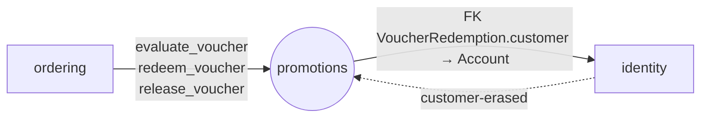

# Module `promotions`

> Trạng thái: **Đã chốt cho MVP**, code _(kế hoạch)_. Khuôn chung: [02 mục 4](../02-backend-structure.md#4-khuôn-mẫu-một-module).

## 1. Sở hữu

- Voucher và Lượt dùng Voucher. Giá khuyến mãi của Biến thể **không** ở đây mà ở [`catalog`](./catalog.md).
- Lớp 4: FK tới `Account`, nghe sự kiện `identity`. Chỉ `ordering` gọi vào.

## 2. Cây thư mục

```
apps/promotions/
├── apps.py                    # name = "apps.promotions", label = "promotions"
├── contracts.py               # mục 4.1
├── exceptions.py              # VoucherNotApplicable
├── constants.py               # loại Voucher (%, số tiền), trạng thái Lượt dùng
├── models.py                  # Voucher, VoucherRedemption
├── services.py                # tính, ghi, trả Lượt dùng; quản lý Voucher
├── handlers.py                # identity.customer-erased
├── api/backoffice/            # quản lý Voucher
├── migrations/
└── tests/                     # soi gương cây ở trên; factories.py; concurrency/ (usage_limit)
```

## 3. Quan hệ với module khác



## 4. Public API

### 4.1. `contracts.py`

| Hàm | Khi nào | Ghi chú |
|---|---|---|
| `evaluate_voucher(code, subtotal, customer_id, phone) -> VoucherQuoteDTO` | Tính thử, checkout (ngoài transaction) | Không khoá. DTO mang đủ đầu vào của lần tính và mức giảm |
| `redeem_voucher(quote, reference)` | Trong transaction checkout | Khoá dòng Voucher, kiểm lại mọi điều kiện của `quote` (hạn dùng, giá trị tối thiểu, `usage_limit`, `per_customer_limit`, mức giảm). Đúng thì ghi `VoucherRedemption`, sai thì ném `VoucherNotApplicable` |
| `release_voucher(reference)` | Huỷ đơn trước Đang giao | Trả lại Lượt dùng |

### 4.2. `exceptions.py`

`VoucherNotApplicable`: Voucher không dùng được cho đơn này (hết hạn, chưa đủ giá trị, hết lượt…).

## 5. Quy tắc riêng

- `per_customer_limit` đếm các lượt trùng `customer_id` **hoặc** trùng số điện thoại liên hệ của đơn đang đặt (BR-VCH-07).
- Handler `identity.customer-erased`: ẩn danh `phone` trong `VoucherRedemption`, lấy đối tượng qua `identity.contracts.get_erasure_subject`.

## 6. Tài liệu liên quan

- Schema: [03 mục 5](../03-data-model.md#5-promotions)
- Quy tắc Voucher BR-VCH: [business/04](../../business/04-business-rules.md)
- Checkout dùng Voucher: [`ordering` mục 5.1](./ordering.md#51-luồng-checkout)
