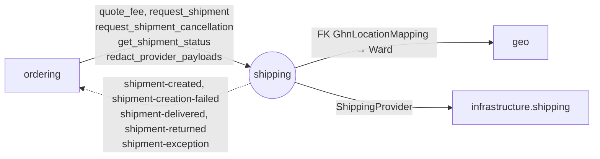

# Module `shipping`

> Trạng thái: **Đã chốt cho MVP**, code _(kế hoạch)_. Khuôn chung: [02 mục 4](../02-backend-structure.md#4-khuôn-mẫu-một-module).

## 1. Sở hữu

- Báo giá Phí ship, Vận đơn GHN, webhook, Đối soát Vận đơn, ánh xạ địa chỉ sang mã GHN, cấu hình Phí ship dự phòng.
- Lớp 3, **không biết gì về Đơn hàng**: chỉ dùng `reference` (Mã đơn), báo kết quả bằng sự kiện.
- Code gọi API GHN ở `infrastructure/shipping/`.

## 2. Cây thư mục

```
apps/shipping/
├── apps.py                    # name = "apps.shipping", label = "shipping"
├── contracts.py               # mục 4.1
├── events.py                  # mục 4.2
├── exceptions.py
├── constants.py               # ShipmentStatus (có creation_unknown, cancel_requested)…
├── models.py                  # Shipment, ShipmentEvent (webhook gốc), GhnLocationMapping, ShippingSettings
├── services.py                # báo giá, tạo/huỷ Vận đơn, ghi webhook
├── tasks.py                   # mục 5.2
├── api/
│   ├── webhooks/              # POST /api/v1/webhooks/ghn
│   └── backoffice/            # settings/ghn-locations
├── migrations/
└── tests/                     # soi gương cây ở trên; factories.py

infrastructure/shipping/       # không phải module; chỉ shipping được import
├── base.py                    # interface ShippingProvider: quote, create_shipment, find_by_client_code,
│                              # get_status, cancel_shipment
├── ghn.py
└── fake.py                    # chỉ dùng được khi FAKE_PROVIDERS_ENABLED
```

## 3. Quan hệ với module khác



## 4. Public API

### 4.1. `contracts.py`

Trừ `quote_fee`, mọi hàm chỉ đọc, ghi DB, đẩy task sau commit, nên gọi trong transaction (kể cả handler) an toàn. HTTP tới GHN chỉ chạy trong task. `reference` là Mã đơn.

DTO:

- `ShippingQuoteDTO`: `fee: int` (Phí ship trước Ngưỡng miễn phí ship), `source: ghn | fallback`, `fallback_reason: str | None`, `config_revision: str` (revision cấu hình shop/dịch vụ/mapping đã dùng). `ordering` tự tính `shipping_fingerprint` của `quote_token` từ các field này và request ([04 mục 5.3](../04-api-contract.md#53-vòng-đời-quote_token)).
- `ShipmentRequestDTO`: `reference: str`, `recipient {name, phone (E.164), street, ward_code}`, `items: list[{sku, name, quantity: int, weight_grams: int}]`, `declared_value: int`, `cod_amount: int` (bằng Tổng tiền đơn với COD, 0 với online). Cấu hình shop, dịch vụ, kích thước gói và mapping GHN do `shipping` tự thêm khi dựng `ShipmentCreationInputV1` ([03 mục 7.1](../03-data-model.md#71-shipping_shipment-vận-đơn)).
- `ShipmentStatusDTO`: `status: ShipmentStatus`, `provider_order_code: str | None`, `updated_at: datetime`.

| Hàm | Ghi chú |
|---|---|
| `quote_fee(ward_code: str, weight_grams: int, declared_value: int) -> ShippingQuoteDTO` | Gọi GHN trực tiếp nên phải gọi **ngoài** transaction. Cache theo hash toàn bộ request đã chuẩn hoá (gồm cấu hình shop, service, kích thước, mapping); không cache Phí ship dự phòng chung với giá GHN thật. `ordering` tự áp Ngưỡng miễn phí ship |
| `request_shipment(request: ShipmentRequestDTO) -> None` | Tạo Vận đơn `requested` với snapshot và mã shop ổn định, đẩy task sau commit. Dùng lại Vận đơn `failed` chỉ khi chắc chắn chưa có Vận đơn bên ngoài; `creation_unknown` thì không tạo lại |
| `request_shipment_cancellation(reference: str) -> None` | Ghi `cancel_requested`, đẩy task `cancel_shipment` sau commit |
| `get_shipment_status(reference: str) -> ShipmentStatusDTO \| None` | `ordering` kiểm trước khi Staff huỷ đơn `PACKING` (T9): `requested`/`creation_unknown` → `ShipmentInProgress` |
| `redact_provider_payloads(reference: str) -> None` | Ẩn danh dữ liệu webhook gốc |

### 4.2. `events.py`

| Sự kiện | `event_type` | Payload | Phát khi |
|---|---|---|---|
| `ShipmentCreatedV1` | `shipping.shipment-created` | `reference: str`, `provider_order_code: str` | Tạo Vận đơn thành công chắc chắn |
| `ShipmentCreationFailedV1` | `shipping.shipment-creation-failed` | `reference: str`, `reason: str` | Tạo Vận đơn thất bại chắc chắn |
| `ShipmentDeliveredV1` | `shipping.shipment-delivered` | `reference: str`, `delivered_at: datetime` | GHN báo đã giao |
| `ShipmentReturnedV1` | `shipping.shipment-returned` | `reference: str` | GHN báo Hoàn hàng |
| `ShipmentExceptionV1` | `shipping.shipment-exception` | `reference: str`, `provider_status: str` | Sự cố Vận đơn: GHN báo mất hàng, hư hàng, sự cố, hoặc tự huỷ Vận đơn mà hệ thống không yêu cầu |

## 5. Quy tắc riêng

### 5.1. Tạo và huỷ Vận đơn

- Task `create_shipment` (queue `integrations`): claim lease, tra theo mã shop trước khi retry. Chỉ phát khi biết chắc kết quả: `ShipmentCreatedV1` hoặc `ShipmentCreationFailedV1`; timeout thì giữ `creation_unknown` ([06 mục 4.3](../06-integrations.md#43-khôi-phục-tạo-vận-đơn-chưa-rõ-kết-quả)).
- Task `cancel_shipment` (queue `integrations`, có retry): thành công → `cancelled`; hết retry → giữ `cancel_requested`, báo Sentry, Staff xử lý tay theo Cờ cần xử lý `shipment_after_cancel`.
- `GhnLocationMapping` ánh xạ `geo.Ward` sang ID GHN; Admin sửa qua back-office.
- Service tra mapping rồi truyền mã vào adapter; adapter không đọc database.

### 5.2. Job

| Task | Tần suất | Việc |
|---|---|---|
| `reconcile_shipments` | Mỗi 15 phút | Đối soát: quét `requested`/`creation_unknown` hết lease để tra theo mã shop; `cancel_requested` quá 15 phút thì thử huỷ lại; chỉ hỏi GHN về Vận đơn không có cập nhật trong 6 giờ ([06](../06-integrations.md) mục 4) |

## 6. Tài liệu liên quan

- Schema: [03 mục 7](../03-data-model.md#7-shipping)
- Tích hợp GHN, ánh xạ trạng thái, địa chỉ 2 cấp và 3 cấp: [06](../06-integrations.md) mục 4
- Quyết định: [ADR 0005](../../adr/0005-provider-adapters-fake-gateways.md)
